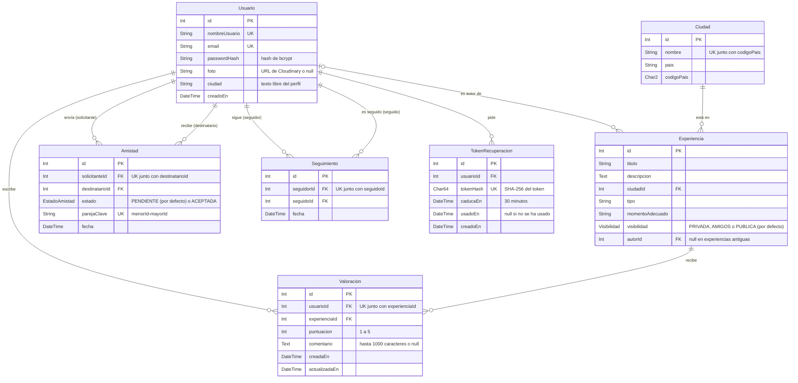

# Herramientas e instalación

Qué hace cada herramienta del stack y cómo instalarla en Windows, macOS y Linux. Es material de aprendizaje y puesta en marcha; las reglas técnicas están en [arquitectura.md](../arquitectura.md).

### 3. Herramientas

Todo el proyecto está escrito en **JavaScript**, tanto el backend como el frontend.

| Capa | Herramientas |
|---|---|
| Base de datos | MySQL |
| Persistencia | Prisma |
| Backend (rutas y lógica) | Node.js, Express, bcrypt, express-session (con prisma-session-store), helmet, express-rate-limit, multer, Nodemailer |
| Interfaz | HTML, CSS, JavaScript, Bootstrap (solo su CSS) |
| Protección contra bots | Cloudflare Turnstile |
| Imágenes | Cloudinary |
| Entorno de desarrollo | Docker (docker-compose) |
| Pruebas | Jest (con jsdom), Supertest |

#### 3.1. MySQL

Sistema de gestión de bases de datos relacional. Guarda la información en tablas (usuarios, experiencias, valoraciones...) relacionadas entre sí mediante claves, y la consulta con SQL.

* Es adecuado para datos muy relacionados, como los de PlanB: un usuario tiene experiencias, que tienen valoraciones de otros usuarios.
* Garantiza la integridad de los datos: claves foráneas, restricciones de unicidad (por ejemplo, una sola valoración por usuario y experiencia) y transacciones.
* Es muy conocido y tiene mucha documentación.

#### 3.2. Prisma

ORM (*Object-Relational Mapping*) para Node.js. El esquema de la base de datos se describe en un único archivo, `backend/prisma/schema.prisma`, y a partir de él Prisma crea las tablas en MySQL y genera un cliente para consultarlas desde JavaScript.

```js
const experiencias = await prisma.experiencia.findMany({
  where: { autorId: 7, visibilidad: { in: ['AMIGOS', 'PUBLICA'] } },
  include: { ciudad: true },
});
```

El ejemplo de consulta pertenece a un repositorio.

**D3 · Modelo de datos.** Las tablas de `schema.prisma`, con sus claves primarias (PK), foráneas (FK) y únicas (UK). En cada relación, `||` significa «exactamente uno», `|o` «cero o uno» y `o{` «cero o muchos».



Además, la tabla `Session` guarda las sesiones de express-session (la gestiona la librería prisma-session-store y no se relaciona con las demás).

Qué garantiza cada restricción:

* **Experiencia:** `ciudadId` identifica una ciudad del catálogo; la clave foránea impide usar ciudades inexistentes y borrar ciudades con experiencias. `autorId` admite ausencia de valor únicamente para conservar registros anteriores sin autor conocido; la creación desde la API siempre asigna al usuario de la sesión. `visibilidad` vale `PUBLICA` por defecto, de modo que las experiencias anteriores y las creadas sin indicarla siguen visibles.
* **Ciudad:** el nombre por sí solo no es único; la combinación de código de país y nombre sí lo es. País y código admiten ausencia de valor para conservar ciudades anteriores pendientes de revisión.
* **Valoracion:** la restricción única `[usuarioId, experienciaId]` impide que un usuario tenga dos valoraciones de la misma experiencia, también con peticiones simultáneas. La base de datos solo garantiza que la puntuación sea un entero; el rango y la longitud del comentario los valida el servicio.
* **Amistad:** entre dos usuarios solo puede haber una relación, en cualquier sentido: `parejaClave` guarda la pareja sin orden (`"3-7"` tanto si 3 envió la solicitud a 7 como al revés) y es única. Rechazar una solicitud o eliminar la amistad borra la fila.
* **Seguimiento:** es direccional; `[seguidorId, seguidoId]` es único, así que no se puede seguir dos veces a la misma persona.
* **TokenRecuperacion:** solo se guarda el hash del token del enlace, nunca el token. Si se borra el usuario, se borran sus enlaces.

El catálogo inicial de capitales y sedes se guarda en `backend/data/capitales.json` y se carga desde `backend/` con `npm run db:seed`, después de aplicar las migraciones. La carga pasa por un servicio y un repositorio, funciona sin internet y puede repetirse sin duplicar sus entradas. Incluye 195 países y 201 entradas. En la interfaz, la ciudad se elige en un desplegable que se rellena con `GET /api/ciudades`.

* **Migraciones:** cada cambio del esquema genera un archivo de migración que se guarda en git. Cualquier miembro del equipo deja su base de datos al día con `npx prisma migrate deploy` (o `npm run db:migrate`, que además crea migraciones nuevas).
* **Relaciones sencillas:** los datos relacionados se piden con `include` o `select`, sin escribir los JOIN a mano. Los campos que se pueden enseñar de un usuario (`id`, `nombreUsuario`, `foto`) se definen una sola vez en `repositories/shared/camposPublicos.js`.
* **Seguridad:** todas las consultas van parametrizadas, lo que evita la inyección SQL.

#### 3.3. Node.js

Entorno que ejecuta JavaScript fuera del navegador, en el servidor.

* Se usa el mismo lenguaje en el frontend y en el backend.
* Tiene el ecosistema de paquetes más grande que existe (npm), con librerías para casi cualquier necesidad.
* Maneja bien muchas peticiones simultáneas, como las de una aplicación web.

#### 3.4. Express

Framework web minimalista para Node.js. Asocia cada URL y método HTTP (`GET /api/experiencias/7`, `PUT /api/experiencias/7/valoracion`...) con la función que la atiende.

* Es sencillo y tiene muy poca configuración inicial.
* Funciona con *middlewares*: funciones que se ejecutan antes de atender la petición, como comprobar la sesión o limitar los intentos. Así esas comprobaciones se escriben una vez y se reutilizan en todas las rutas.
* También sirve archivos estáticos, así que el mismo servidor entrega tanto la API como las páginas HTML.

#### 3.5. bcrypt

Librería que calcula el *hash* de una contraseña, es decir, una transformación que no se puede deshacer.

* En la base de datos nunca se guarda la contraseña, solo su hash. Aunque alguien obtuviese la base de datos, no podría leer las contraseñas.
* Es lento a propósito y añade un valor aleatorio (*salt*) a cada contraseña, lo que dificulta mucho los ataques por fuerza bruta.

#### 3.6. express-session

Middleware de Express que gestiona las **sesiones** de usuario. Al iniciar sesión, el servidor crea una sesión y el navegador recibe una cookie con su identificador. En cada petición siguiente, el navegador envía esa cookie y el backend sabe qué usuario la hace.

* El navegador envía la cookie automáticamente, sin código extra en el frontend.
* La cookie se marca como `HttpOnly`, así que el JavaScript de la página no puede leerla, lo que protege frente a robos por XSS.
* Cerrar sesión es inmediato: basta con borrar la sesión en el servidor.
* Las sesiones se guardan en MySQL (tabla `Session`) mediante **@quixo3/prisma-session-store**, que usa el mismo cliente de Prisma. Así sobreviven a los reinicios del servidor, y las caducadas se borran solas.

#### 3.7. HTML, CSS y JavaScript

Las tres tecnologías básicas de la web. HTML define la estructura de cada página, CSS su aspecto y JavaScript su comportamiento. El JavaScript del frontend pide datos a la API con `fetch` y los inserta en la página.

* No hace falta ningún paso de compilación: los archivos se abren directamente en el navegador.
* No hay que aprender ningún framework adicional.

#### 3.8. Bootstrap

Librería de CSS y componentes (botones, formularios, tarjetas, menús...) listos para usar. PlanB carga solo su CSS: las ventanas emergentes usan el elemento `<dialog>` del navegador, porque la política de seguridad de contenidos no permite cargar scripts de otros servidores (sección 3.13).

* Su sistema de rejilla hace que las páginas se adapten al móvil sin escribir CSS específico, que es la base de una web responsive.
* Da un aspecto uniforme a todas las pantallas aunque las haga gente distinta.

#### 3.9. Cloudinary

Servicio en la nube para almacenar y servir imágenes. El backend sube cada foto a Cloudinary y en MySQL se guarda solo su URL.

* La base de datos no se llena de archivos pesados.
* Redimensiona y optimiza las imágenes automáticamente.
* El plan gratuito es suficiente para el proyecto.

El navegador envía la foto en un formulario *multipart* (el formato de los formularios con archivos). En el backend, **multer** la recibe en memoria, sin escribirla en disco, y el SDK oficial **cloudinary** la sube con las credenciales de la variable `CLOUDINARY_URL` de `.env`.

#### 3.10. Docker (docker-compose)

Docker ejecuta programas dentro de **contenedores**, que son entornos aislados con una configuración fija. `docker-compose` permite describir en un archivo (`docker-compose.yml`) qué contenedores levantar.

* Todo el equipo usa la misma versión y configuración de MySQL, sin instalarlo en su ordenador.
* La base de datos se levanta con un solo comando (`docker compose up -d`) y se puede borrar y recrear en segundos.

#### 3.11. Jest

Framework de pruebas para JavaScript. Ejecuta los tests, comprueba los resultados con aserciones (`expect(resultado).toBe(...)`) e indica qué ha fallado.

* Necesita muy poca configuración.
* Permite sustituir partes del sistema por simulaciones (*mocks*), por ejemplo para probar la lógica de negocio sin base de datos o sin subir fotos a Cloudinary.
* Con el entorno **jsdom** (`jest-environment-jsdom`) simula un navegador: carga el HTML y el JavaScript de una pantalla y comprueba lo que ve el usuario (mensajes, estado de los botones) sin abrir un navegador real.
* Mide la **cobertura**: qué partes del código ejecutan las pruebas (sección 9).

#### 3.12. Supertest

Librería que hace peticiones HTTP a la aplicación Express desde los tests, sin arrancar un servidor real.

* Permite probar cada endpoint de principio a fin: se envía una petición y se comprueban el código de estado y el JSON devuelto.
* Encaja directamente con los criterios de validación de las tarjetas de historias de usuario («si una experiencia pública pasa a privada, otro usuario no debe poder volver a consultarla»...).

#### 3.13. helmet

Middleware de Express que añade a cada respuesta las **cabeceras de seguridad** que le dicen al navegador cómo protegerse.

* **Política de contenido (CSP):** el navegador solo ejecuta scripts de nuestro propio servidor (y los del CAPTCHA de Cloudflare). Aunque alguien consiguiera colar un `<script>` en una página, no se ejecutaría. Por eso no se usan atributos como `onclick` ni scripts de otros servidores.
* Impide que otra web muestre PlanB dentro de un marco para engañar al usuario (*clickjacking*).
* Deja de anunciar que el servidor usa Express.

#### 3.14. express-rate-limit

Middleware que **limita cuántas peticiones** puede hacer una misma IP en un periodo de tiempo. Al superar el límite, responde `429 Too Many Requests`.

* Frena los ataques de fuerza bruta contra el login y el cambio de contraseña, la creación masiva de cuentas y el envío masivo de enlaces de recuperación.
* Se aplica solo a las rutas que lo necesitan, como un middleware más (`middlewares/limitesMiddleware.js`).

#### 3.15. Cloudflare Turnstile

**CAPTCHA** gratuito de Cloudflare que comprueba que quien usa un formulario es una persona y no un programa. La mayoría de las veces no pide nada al usuario: lo decide analizando el navegador.

* El navegador resuelve el CAPTCHA y envía un *token* junto con el formulario; el backend pregunta a Cloudflare si ese token es válido antes de hacer nada más.
* En el registro impide que un programa pruebe emails en masa para averiguar cuáles tienen cuenta.
* Para desarrollo, Cloudflare ofrece claves de prueba que siempre aceptan, así que no hace falta crear una cuenta hasta el despliegue.

#### 3.16. Nodemailer

Librería para enviar emails desde Node.js a través de un servidor de correo **SMTP**. PlanB la usa para el enlace de recuperación de la contraseña (CS-64).

* La dirección del servidor y sus credenciales van en la variable `SMTP_URL` de `.env`, así que se puede cambiar de proveedor sin tocar el código.
* Sin `SMTP_URL` (desarrollo), `repositories/emailRepository.js` escribe el email en la consola del servidor, para poder abrir el enlace sin configurar ningún proveedor.


### 7. Instalación de herramientas

Para desarrollar solo hace falta instalar tres programas. Todo lo demás se instala solo o no necesita instalación:

* **MySQL** se ejecuta dentro de Docker, así que no se instala en el ordenador.
* **Express, Prisma, Jest y el resto de librerías** se descargan con `npm install` (sección 8).
* **Bootstrap** se carga desde CDN en cada página.

| Herramienta | Para qué | Versión |
|---|---|---|
| Git | Clonar el repositorio y trabajar con ramas | Cualquiera reciente |
| Node.js (incluye npm) | Ejecutar el backend e instalar sus librerías | LTS, 22 o superior |
| Docker (con Docker Compose) | Levantar MySQL | Cualquiera reciente |

Opcional: para ver los diagramas de la documentación en la vista previa de Markdown de Visual Studio Code, instalar la extensión **Markdown Preview Mermaid Support**. En GitHub se ven sin instalar nada.

#### 7.1. Windows

1. **Git:** descargar e instalar [Git for Windows](https://git-scm.com/download/win).
2. **Node.js:** descargar el instalador **LTS** de [nodejs.org](https://nodejs.org/) y seguir el asistente con las opciones por defecto.
3. **Docker:** instalar [Docker Desktop](https://docs.docker.com/desktop/setup/install/windows-install/). Durante la instalación, dejar marcada la opción de usar **WSL 2**. Reiniciar si lo pide y abrir Docker Desktop, que tiene que estar en marcha para usar `docker`.

#### 7.2. macOS

1. **Git:** ejecutar `git --version` en la terminal. Si no está instalado, macOS ofrece instalar las *Command Line Tools*, que lo incluyen.
2. **Node.js:** descargar el instalador **LTS** de [nodejs.org](https://nodejs.org/), o con Homebrew: `brew install node`.
3. **Docker:** instalar [Docker Desktop](https://docs.docker.com/desktop/setup/install/mac-install/) (elegir la versión Apple Silicon o Intel según el equipo) y abrirlo.

#### 7.3. Linux (Ubuntu, Linux Mint y derivadas)

Los comandos se ejecutan en **bash**.

**Git:**

```bash
sudo apt-get update
sudo apt-get install -y git
```

**Node.js**, desde el repositorio oficial de NodeSource (sustituir `24` por la versión LTS vigente si ha cambiado):

```bash
curl -fsSL https://deb.nodesource.com/setup_24.x | sudo -E bash -
sudo apt-get install -y nodejs
```

**Docker Engine**, desde el repositorio oficial de Docker:

```bash
sudo apt-get install -y ca-certificates curl
sudo install -m 0755 -d /etc/apt/keyrings
sudo curl -fsSL https://download.docker.com/linux/ubuntu/gpg -o /etc/apt/keyrings/docker.asc
sudo chmod a+r /etc/apt/keyrings/docker.asc
echo "deb [arch=$(dpkg --print-architecture) signed-by=/etc/apt/keyrings/docker.asc] https://download.docker.com/linux/ubuntu $(. /etc/os-release && echo "${UBUNTU_CODENAME:-$VERSION_CODENAME}") stable" \
  | sudo tee /etc/apt/sources.list.d/docker.list > /dev/null
sudo apt-get update
sudo apt-get install -y docker-ce docker-ce-cli containerd.io docker-buildx-plugin docker-compose-plugin
```

Para usar `docker` sin `sudo`, añadir el usuario al grupo `docker` y **cerrar sesión y volver a entrar**:

```bash
sudo usermod -aG docker $USER
```

En Linux Mint, `UBUNTU_CODENAME` hace que se use el repositorio de la versión de Ubuntu en la que se basa.

#### 7.4. Comprobar la instalación

```bash
git --version
node -v                 # v22.x o superior
npm -v
docker --version
docker compose version
docker run --rm hello-world   # descarga una imagen de prueba y muestra un mensaje de bienvenida
```

Si todos los comandos responden sin error, el equipo está listo para la puesta en marcha de la sección 8.


