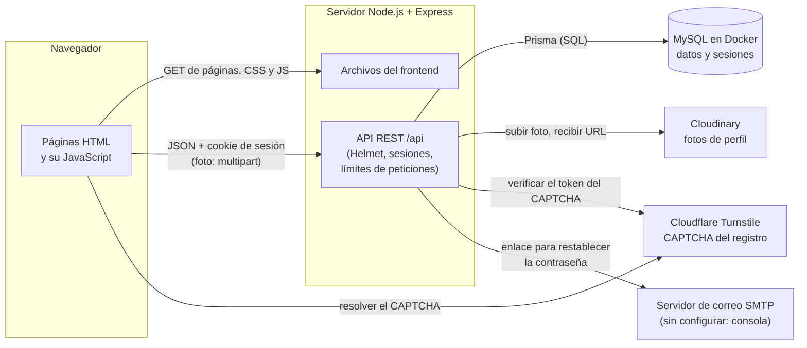
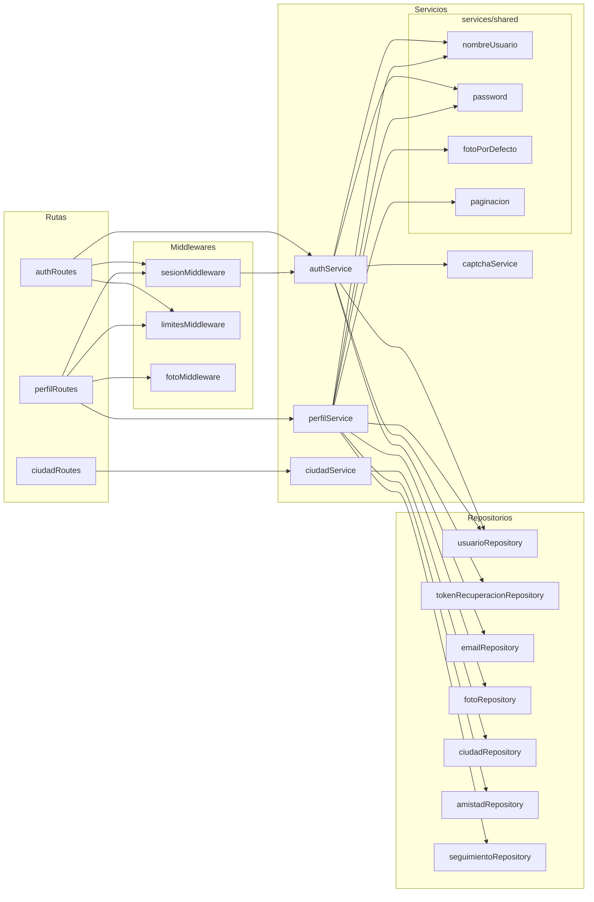
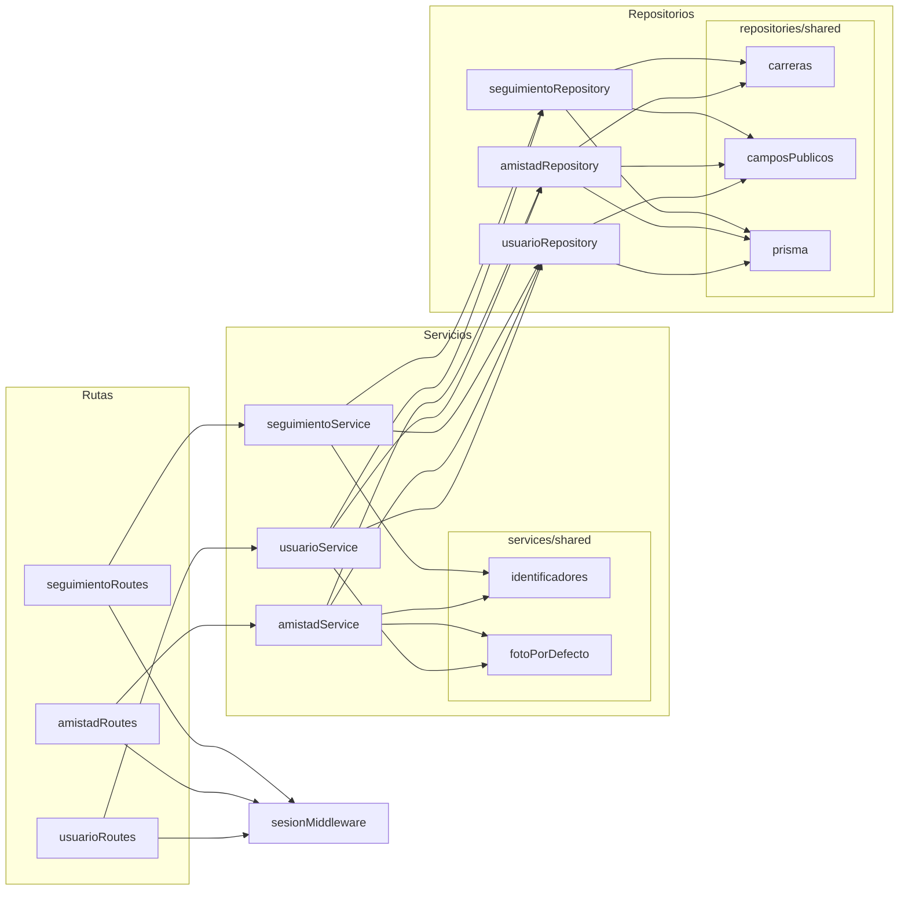
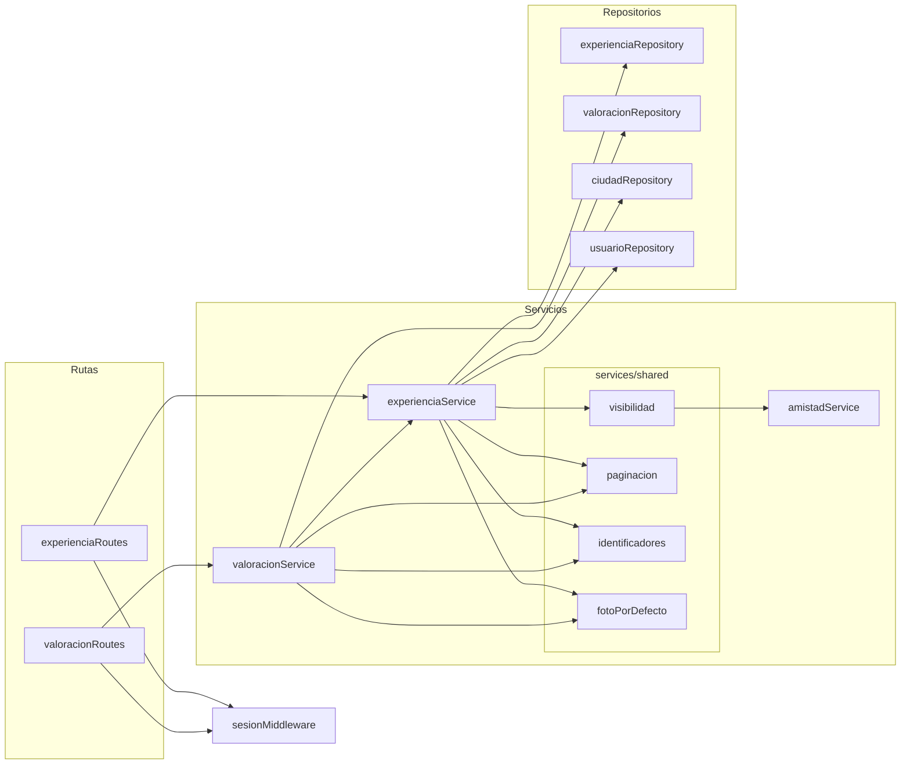
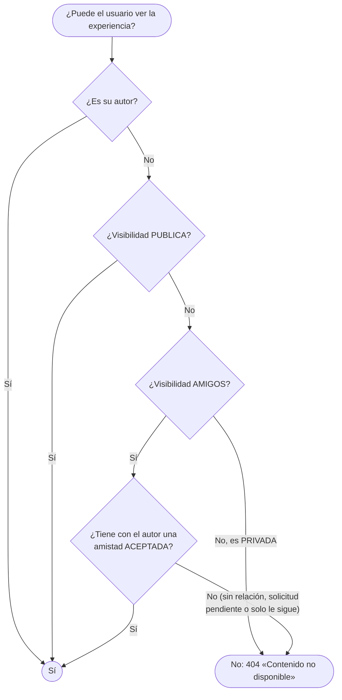
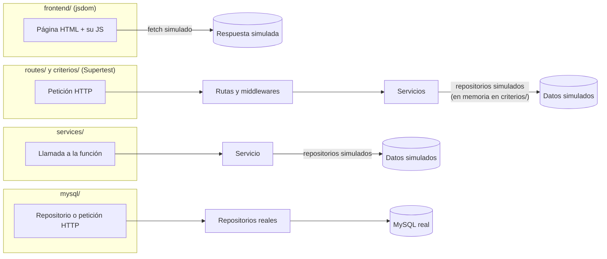

# Arquitectura — PlanB

> Arquitectura y diseño técnico del proyecto: las reglas estables. Parte de la [propuesta inicial](anexo/propuesta-inicial.md).
> Documentos relacionados: [referencia de la API](api.md), [flujos y estados](flujos.md), [pantallas](frontend.md) y [glosario](anexo/glosario.md).

Los diagramas están escritos en [Mermaid](anexo/glosario.md#mermaid): GitHub los dibuja directamente y, en Visual Studio Code, se ven con la extensión «Markdown Preview Mermaid Support» (anexo).


### 1. Alcance técnico

PlanB se construye como una **aplicación web responsive**: una única web que se adapta tanto al ordenador como a la pantalla del móvil. No hay aplicación móvil nativa.

Funcionalidades implementadas, con su historia de usuario:

| Historia | Qué permite |
|---|---|
| CS-59 · Crear una cuenta | Registro con CAPTCHA, inicio y cierre de sesión |
| CS-64 · Contraseña segura | Requisitos de la contraseña, cambiarla desde el perfil y recuperarla por email |
| CS-47 · Crear mi perfil | Ver y editar el perfil propio, con su foto |
| CS-49 · Creación de experiencias | Crear experiencias con su ciudad del catálogo |
| CS-57 · Edición de experiencia | Editar las experiencias propias |
| CS-22 · Visibilidad experiencias | Privada, de amigos o pública, con su descripción en el formulario |
| CS-30 · Control de acceso | Solo se ve una experiencia si su visibilidad lo permite; si no, «Contenido no disponible» |
| CS-44 · Mis experiencias publicadas | Las experiencias de un usuario en su perfil, por páginas |
| CS-61 · Amistades y seguidores | Buscar personas, solicitudes de amistad y seguir |
| CS-45 · Mi número de amigos y seguidores | Contadores y listas en «Mi perfil» |
| CS-62 · Perfil de otro usuario | Su perfil público, la relación con él y sus experiencias |
| CS-01 · Valorar una experiencia | Puntuación del 1 al 5 y comentario opcional |
| CS-63 · Pantalla de valoraciones | La página de una experiencia con sus valoraciones; «Útil» y «Reportar» solo en la pantalla hasta CS-02 y CS-04 |
| CS-48 · Valoraciones de amigos y seguidores | Sección propia en la página de la experiencia |

El resto de módulos se construye después sobre la misma arquitectura.


### 2. Visión general

El sistema se organiza en **capas**. No son servicios independientes: hay un único backend con las capas separadas por dentro (carpetas y módulos), y un frontend que se comunica con él.

**D1 · Contexto.** Quién habla con quién y qué viaja en cada conexión.



* **Interfaz:** lo que ve y usa la persona. Son páginas HTML que piden datos al backend y los muestran.
* **Rutas:** reciben cada petición HTTP, comprueban con un *middleware* que el usuario tenga sesión iniciada y pasan la petición a la lógica de negocio.
* **Lógica de negocio (servicios):** aplica las reglas de las historias de usuario: qué puede hacer cada usuario, cómo se valida cada dato y qué se calcula.
* **Persistencia (repositorios):** la única parte del código que habla con la base de datos y con los servicios externos (Cloudinary y el correo). Lee y guarda datos y los devuelve como objetos de JavaScript.
* **MySQL:** almacena los datos. No sabe nada de reglas de negocio.

Cada capa solo se comunica con la de al lado, de modo que se puede probar o cambiar por separado sin tocar el resto.

#### 2.1. Capas y archivos

**D2 · Quién usa a quién.** Cada flecha es un `require` del código: la ruta llama a su servicio y el servicio a sus repositorios. Para que se pueda leer, va en tres diagramas por área. Las carpetas `shared/` reúnen lo que usan varios archivos de la misma capa.

*D2a · Cuenta y perfil*



*D2b · Personas y relaciones*



*D2c · Experiencias y valoraciones*



`valoracionService` usa `experienciaService.obtenerExperiencia` para comprobar que la experiencia existe y se puede ver: la regla de acceso de CS-30 está en un solo sitio. Todos los repositorios de MySQL usan `repositories/shared/prisma.js`; `fotoRepository` habla con Cloudinary y `emailRepository` con el servidor de correo.


### 3. Herramientas

Todo el proyecto está escrito en **JavaScript**. Backend: Node.js, Express, Prisma sobre MySQL, `express-session` con `bcrypt`, `helmet`, `express-rate-limit`, Cloudinary (fotos), Nodemailer (correo) y Cloudflare Turnstile (captcha). Frontend: HTML, CSS y JavaScript sin framework, con Bootstrap. Pruebas: Jest, Supertest y jsdom. MySQL se ejecuta en Docker (`docker-compose`).

Qué hace cada herramienta: [anexo/herramientas-e-instalacion.md](anexo/herramientas-e-instalacion.md).


### 4. Comunicación entre frontend y backend

* El backend expone una **API REST** que recibe y devuelve **JSON**. Todas sus rutas empiezan por `/api` (por ejemplo, `GET /api/experiencias/7`). La referencia completa de cada ruta está en [api.md](api.md).
* El resto de rutas sirven las páginas HTML del frontend. Frontend y API salen del **mismo servidor y el mismo dominio**, por lo que la cookie de sesión se envía sola y no hay que configurar CORS.
* Cada endpoint indica el resultado con el código HTTP correspondiente: `200`/`201`/`204` si ha ido bien, `400` si los datos son inválidos, `401` si no hay sesión, `403` si no hay permiso, `404` si el recurso no existe y `429` si se han hecho demasiados intentos.
* Los errores se devuelven como `{ "error": "mensaje" }`, con un mensaje en español que el frontend puede mostrar tal cual. `js/shared/api.js` lanza ese mensaje como error y le añade el código HTTP en `status`.
* Una experiencia que no existe y una que no se puede ver responden igual: **404 «Contenido no disponible»**, para no revelar que existe (CS-30).
* Los listados se piden por páginas con **paginación por cursor**: `?despuesDe=<id>&limite=<n>` y la respuesta trae `siguiente`, el valor para pedir la página siguiente (`null` si no hay más). Así no se repite ni se salta ningún elemento aunque la lista cambie entre dos peticiones ([flujo F9](flujos.md#f9-listas-con-cargar-más)).


### 5. Autenticación y autorización

#### 5.1. Autenticación

* Registro e inicio de sesión con **email y contraseña**. La secuencia completa está en los flujos [F1](flujos.md#f1-registro) y [F2](flujos.md#f2-inicio-de-sesión-y-petición-protegida).
* La contraseña se guarda como hash con **bcrypt** y tiene que cumplir los requisitos de CS-64 (`services/shared/password.js`): entre 8 y 72 bytes, mayúscula, minúscula, número y sin el nombre de usuario.
* La sesión se mantiene con **express-session** mediante una cookie `HttpOnly`. Al iniciar sesión se crea siempre una sesión nueva, para que nadie pueda reutilizar un identificador anterior.
* El middleware `requiereSesion` protege las rutas: sin sesión, o si el usuario de la sesión ya no existe, responde 401 y la petición no llega a la ruta. Así los servicios dan por bueno el usuario de la sesión.
* Todos los datos se validan en el backend (tipo, formato y longitud), aunque el formulario ya los compruebe.
* El login y el cambio de contraseña admiten un número limitado de intentos fallidos por IP, la recuperación de la contraseña un número limitado de peticiones, y el registro exige superar el CAPTCHA.

#### 5.2. Autorización

Los permisos se comprueban **siempre en el backend**. El frontend puede ocultar botones, pero eso no protege nada por sí solo.

* **Visibilidad de experiencias** (CS-22 y CS-30): cualquier consulta que devuelva experiencias (el detalle, el listado de un autor y las valoraciones) filtra según su visibilidad y según quién la pide. La regla está en un solo sitio, `services/shared/visibilidad.js`: `puedeVerExperiencia` decide sobre una experiencia y `nivelesVisibles` da los niveles que puede ver alguien entre las de un autor, para filtrar un listado en una sola consulta.
* **Propiedad:** solo el autor puede editar su experiencia (CS-57), y el autor no puede valorar la suya (CS-01).
* **Amistades:** solo el destinatario puede aceptar o rechazar una solicitud, y solo los dos participantes pueden eliminar una amistad (CS-61).

**D4 · Regla de visibilidad.** Lo que decide `puedeVerExperiencia(usuario, experiencia)`.



Los niveles que devuelve `nivelesVisibles` siguen la misma regla:

| Quién consulta | PRIVADA | AMIGOS | PUBLICA |
|---|:---:|:---:|:---:|
| El autor | ✓ | ✓ | ✓ |
| Un amigo con la amistad aceptada | | ✓ | ✓ |
| Alguien con una solicitud pendiente | | | ✓ |
| Un seguidor que no es amigo | | | ✓ |
| Cualquier otro usuario | | | ✓ |

El permiso se calcula en cada petición: si una experiencia pasa a privada o se elimina una amistad, el acceso se pierde en la siguiente consulta, aunque se use un enlace anterior.


### 6. Estructura del repositorio

```
ISW-Practica/
├── backend/
│   ├── data/capitales.json    # catálogo inicial de ciudades (npm run db:seed)
│   ├── prisma/
│   │   ├── schema.prisma      # esquema de la base de datos
│   │   ├── migrations/        # migraciones generadas por Prisma
│   │   └── seed.js            # carga del catálogo de ciudades
│   ├── src/
│   │   ├── routes/            # URLs de la API → llaman a su servicio (xRoutes.js)
│   │   ├── middlewares/       # sesión, límites de peticiones y recepción de la foto (xMiddleware.js)
│   │   ├── services/          # lógica de negocio (xService.js)
│   │   │   └── shared/        # reglas comunes: visibilidad, paginación, contraseña, ids...
│   │   ├── repositories/      # acceso a datos: MySQL con Prisma, Cloudinary y correo (xRepository.js)
│   │   │   └── shared/        # conexión con MySQL, almacén de sesiones y campos públicos
│   │   ├── errores.js         # crearError: errores con código HTTP, común a todas las capas
│   │   ├── app.js             # configuración de Express
│   │   └── server.js          # arranque del servidor
│   ├── tests/                 # pruebas con Jest, Supertest y jsdom (sección 9)
│   ├── .env.example           # variables de entorno necesarias (sin valores reales)
│   └── package.json           # dependencias, scripts de npm y configuración de Jest
├── frontend/
│   ├── *.html                 # una página por pantalla
│   ├── css/
│   ├── img/
│   └── js/                    # un archivo por página, con el mismo nombre que su HTML
│       └── shared/            # código común a varias páginas (api.js, pantalla.js...)
├── docker-compose.yml         # MySQL para desarrollo
└── documentacion/
    ├── customer-stories/      # documentos de partida y copia obsoleta del libro de historias
    └── *.md                   # propuesta, arquitectura, api, flujos, frontend, glosario...
```

Las carpetas de `backend/src` se corresponden con las capas de la sección 2. Las rutas solo llaman a servicios, los servicios solo llaman a repositorios (y a otros servicios cuando hace falta) y solo los repositorios usan Prisma, Cloudinary o el correo.

Cada archivo lleva el nombre de su capa como sufijo, de modo que el nombre indica dónde está y con quién habla: `perfilRoutes.js` → `perfilService.js` → `usuarioRepository.js`. Cada `xRoutes.js` atiende un prefijo de la URL y llama solo a `xService.js` (la tabla de prefijos está en `routes/index.js`), y cada ruta lleva un comentario con el formato `// GET /api/... → servicio.función`. Las rutas y los servicios se agrupan por funcionalidad y los repositorios por tabla o almacén de datos, por eso varios servicios pueden usar el mismo repositorio. Lo que no pertenece a ninguna funcionalidad ni tabla concreta va en la carpeta `shared/` de su capa. Cada archivo empieza con un comentario que indica su capa, quién lo usa y qué usa.

Las claves y contraseñas (conexión a MySQL, credenciales de Cloudinary, secreto de sesión, servidor de correo) se guardan en `backend/.env`, que **no se sube a git**. El archivo `backend/.env.example` indica qué variables hay que rellenar.

El frontend no necesita instalación: Bootstrap se carga desde CDN y `js/shared/api.js` agrupa las llamadas a la API. Cada página carga primero `js/shared/api.js`, después los módulos compartidos que necesita y por último su propio archivo (`perfil.html` → `js/perfil.js`). El detalle de cada pantalla está en [frontend.md](frontend.md).


### 7. Instalación de herramientas

Hacen falta Git, Node.js (LTS, 22 o superior) y Docker con Docker Compose. Pasos por sistema operativo: [anexo/herramientas-e-instalacion.md](anexo/herramientas-e-instalacion.md).

### 8. Entorno de desarrollo

Requisitos: Git, Node.js y Docker (sección 7).

Puesta en marcha en local, desde la raíz del repositorio:

1. `docker compose up -d` levanta MySQL en `localhost:3306`.
2. `cd backend` y copiar `.env.example` a `.env`. Los valores de la base de datos ya coinciden con `docker-compose.yml`; solo hay que cambiar `SESSION_SECRET` y rellenar `CLOUDINARY_URL` y `SMTP_URL` cuando hagan falta.
3. `npm install` instala las dependencias.
4. `npm run db:migrate` crea o actualiza las tablas a partir de `prisma/schema.prisma`, y `npm run db:seed` carga el catálogo de ciudades (se puede repetir).
5. `npm run dev` arranca el servidor en http://localhost:3000, que sirve la API y la web, y se reinicia solo al guardar cambios.

Tras un `git pull` que traiga migraciones o dependencias nuevas: `npm install`, `npx prisma migrate deploy` y `npx prisma generate`.

Variables de `backend/.env` (ver `.env.example`):

| Variable | Para qué |
|---|---|
| `DATABASE_URL` | Conexión con MySQL |
| `PORT` | Puerto del servidor (3000 por defecto) |
| `SESSION_SECRET` | Firma de la cookie de sesión |
| `TURNSTILE_SITE_KEY`, `TURNSTILE_SECRET_KEY` | CAPTCHA del registro (hay claves de prueba) |
| `CLOUDINARY_URL` | Subida de las fotos de perfil |
| `SMTP_URL` | Servidor de correo para la recuperación de la contraseña; sin ella, el email sale por la consola |
| `EMAIL_REMITENTE` | Remitente de esos emails |
| `URL_APP` | Dirección de la web, para el enlace del email |

Scripts de `backend/package.json`:

| Script | Qué hace |
|---|---|
| `npm run dev` | Arranca el servidor y lo reinicia al cambiar el código |
| `npm start` | Arranca el servidor sin reinicio automático |
| `npm test` | Ejecuta las pruebas con Jest, sin base de datos (todo simulado) |
| `npm run test:mysql` | Ejecuta las pruebas de `tests/mysql/` contra la base de datos del `.env` (Docker en marcha) |
| `npm run test:todo` | Ejecuta `npm test` y después `npm run test:mysql` |
| `npm run test:cobertura` | Ejecuta todas las pruebas, también las de MySQL, con el informe de cobertura |
| `npm run db:migrate` | Aplica los cambios de `schema.prisma` a la base de datos y genera la migración |
| `npm run db:seed` | Carga el catálogo inicial de ciudades sin duplicar entradas |
| `npm run db:studio` | Abre Prisma Studio, una interfaz web para ver y editar los datos |

`docker compose down` para MySQL; los datos se conservan en un volumen de Docker. `docker compose down -v` los borra.


### 9. Pruebas

Antes de cada `git push`, y después de cada merge, hay que ejecutar `npm test` desde `backend/` y comprobar que no queda ningún marcador de conflicto (`git grep -nE '^(<<<<<<<|>>>>>>>) '` no debe encontrar nada).

**D5 · Mapa de pruebas.** Qué parte del sistema ejercita cada tipo de prueba y qué se simula.



Estructura de `backend/tests/`, que copia la de `src/` y `frontend/js/`:

```
backend/tests/
├── setup.js          # antes de cada archivo: sesiones en memoria, límites y CAPTCHA desactivados
├── helpers/          # ayudas, no son pruebas: pantalla.js (cargar una página) y datosMysql.js
├── app.test.js       # rutas inexistentes y cabeceras de seguridad
├── routes/           # una por archivo de rutas (archivo.tema.test.js si hay varias)
├── middlewares/      # sesión y límites de peticiones
├── services/         # una por servicio, y shared/ para las reglas comunes
├── criterios/        # el criterio de una historia de principio a fin, por HTTP (csXX...)
├── frontend/         # una por página, y shared/ para los módulos comunes
└── mysql/            # con MySQL real: repositories/, restricciones y peticiones simultáneas
```

* **Servicios:** pruebas unitarias de la lógica de negocio con los repositorios simulados: validaciones, permisos y cálculos.
* **Rutas y criterios:** pruebas de la API con Supertest. Cada frase del criterio de validación de una tarjeta se traduce en al menos una prueba; las de `criterios/` simulan los repositorios en memoria para recorrer una historia completa.
* **Pantallas (jsdom):** cargan el HTML de una página y su JavaScript (con `require`, para medir su cobertura) y simulan el servidor con `fetch`.
* **MySQL real (`tests/mysql/`):** lo que solo la base de datos puede demostrar: restricciones únicas, peticiones simultáneas, filtros y cursores de las consultas, y que no se devuelven emails. No simulan nada, crean sus propios datos y los borran al terminar. `npm test` no los incluye, para que funcione sin Docker.
* **Navegador real:** las pantallas se comprueban también a mano, en tamaño de ordenador y de móvil.

Para que una prueba valga tiene que **fallar cuando se rompe el comportamiento que protege**. Por eso cada comportamiento nuevo sigue el ciclo TDD (primero la prueba en rojo) y las reglas críticas se comprueban además con una **mutación manual**: se rompe la regla a propósito, se ve la prueba en rojo y se deshace el cambio. No se escriben pruebas que solo comprueban que una función pasa los mismos datos a otra.

Los casos de cada prueba siguen **BICEP**:

| Letra | Qué comprueba | Ejemplo en PlanB |
|---|---|---|
| B (*Boundary*, límites) | Los valores justo en el borde | Puntuación 0, 1, 5 y 6; comentario de 1000 y 1001 caracteres; contraseña de 7, 8, 72 y 73 bytes |
| I (*Inverse*, inversa) | Hacer y deshacer | Seguir y dejar de seguir; pública → privada → pública |
| C (*Cross-check*, verificación cruzada) | El mismo resultado por dos caminos | `nivelesVisibles` coincide con `puedeVerExperiencia` en toda la tabla |
| E (*Error*, errores) | Cada error esperado | 400, 401, 404 «Contenido no disponible», 429; peticiones simultáneas (P2002, P2025) |
| P (*Performance*, rendimiento) | Que escala | Listas por cursor sin OFFSET; CS-48 en una sola consulta |

**Cobertura.** `npm run test:cobertura` ejecuta todas las pruebas (Docker en marcha) y mide qué parte de `backend/src` y de `frontend/js` ejecutan. Falla si baja del 94 % de instrucciones, el 93 % de ramas o el 95 % de funciones. El informe queda en `backend/coverage/` (`backend/coverage/lcov-report/index.html` se abre en el navegador). Lo que no se cubre es lo que depende de un servicio externo real (la subida a Cloudinary y el envío por SMTP), la carga del catálogo de `db:seed` y `server.js`, que solo arranca el servidor.
