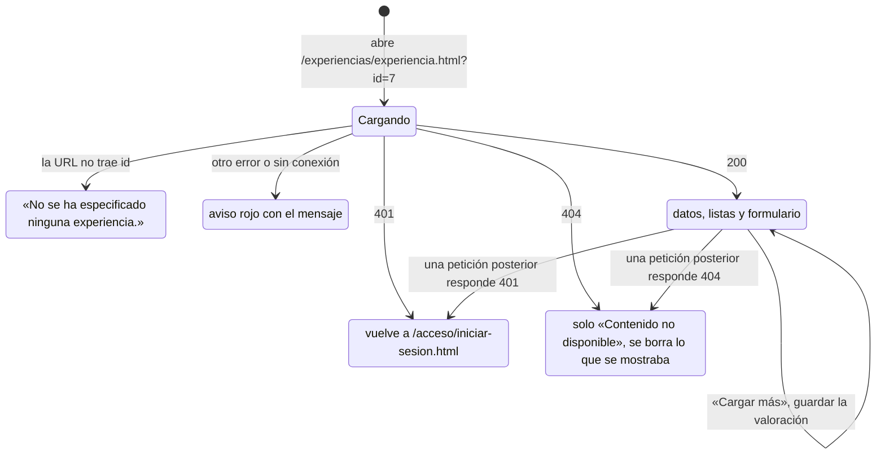
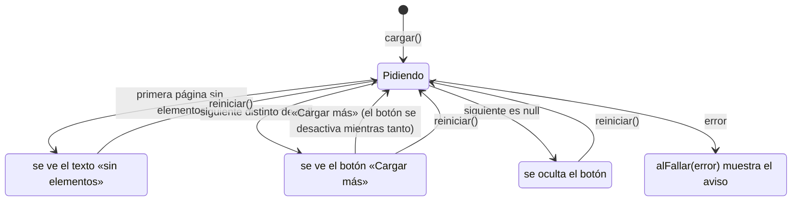

# Pantallas del frontend — PlanB

> Qué pantallas hay, cómo se pasa de una a otra, qué archivos usa cada una y qué llamadas hace a la API.
> Documentos relacionados: [arquitectura](arquitectura.md), [flujos](flujos.md), [referencia de la API](api.md), [glosario](anexo/glosario.md) e [inventario de pantallas](inventario-pantallas.md) (estados y lagunas frente al diseño).

El frontend son páginas HTML estáticas con JavaScript sin *framework* y estilos de Bootstrap 5 (solo su CSS, que carga `css/tokens.css` en una capa) complementados por `css/base.css`, `css/componentes.css` y por el CSS propio de cada grupo de páginas. Está pensado para escritorio; la adaptación a pantallas pequeñas está aparcada. El mismo servidor Express sirve las páginas desde `frontend/` y la API desde `/api`, así que comparten origen y la cookie de sesión viaja sola en cada `fetch`.

## Mapa de navegación

El [sitemap de PlanB](sitemap.mmd) es la referencia del mapa de navegación, en formato Mermaid. Es la maqueta completa del rediseño: las doce páginas actuales y las que aún no existen, agrupadas en seis bloques y marcadas como «implementada», «a reorganizar» o «diseño futuro». Lo marcado «diseño futuro» o «a reorganizar» no existe todavía tal como se dibuja.

```mermaid
%% Copia renderizable de sitemap.mmd. Al modificar el sitemap, actualiza ambos bloques.
%% Sitemap de PlanB — rediseño (maqueta completa).
%% Cada caja es una página; las flechas, enlaces o redirecciones. Estado entre paréntesis: implementada, a reorganizar o diseño futuro.
%% Navegación principal (barra de pestañas): Inicio, Explorar, Mis planes y Amigos. Secundaria: menú de cuenta (Mi perfil, Guardados, Ajustes, Ayuda, Cerrar sesión), campana, «Crear plan», buscador y pie.
%% Línea discontinua: enlace recibido por correo. Sesión no válida (401): se vuelve a Iniciar sesión.
%% Los parámetros de las URL se explican en frontend.md.
flowchart TB
    subgraph g_0["Público"]
        index["Landing<br/>index.html<br/>(implementada)"]
        iniciar_sesion["Iniciar sesión<br/>/acceso/iniciar-sesion.html<br/>(implementada)"]
        registro["Crear cuenta<br/>/acceso/registro.html<br/>(implementada)"]
        recuperar["Recuperar contraseña<br/>/acceso/recuperar.html<br/>(implementada)"]
        restablecer["Restablecer contraseña<br/>/acceso/restablecer.html<br/>(implementada)"]
        ayuda["Ayuda<br/>ayuda.html<br/>(diseño futuro)"]
        terminos["Términos y privacidad<br/>terminos.html<br/>(diseño futuro)"]
        no_encontrada["Página no encontrada (404)<br/>no-encontrada.html<br/>(diseño futuro)"]
    end
    subgraph g_1["Inicio y descubrir"]
        bienvenida["Inicio<br/>/cuenta/bienvenida.html<br/>(implementada)"]
        explorar["Explorar<br/>explorar.html<br/>(implementada)"]
        ciudad["Ciudad<br/>ciudad.html?id=<br/>(diseño futuro)"]
        personas["Resultados de búsqueda<br/>/social/personas.html<br/>(a reorganizar)"]
    end
    subgraph g_2["Planes"]
        experiencia["Detalle del plan<br/>/experiencias/experiencia.html?id=<br/>(implementada)"]
        crear_plan["Crear plan<br/>crear-plan.html<br/>(a reorganizar)"]
        editar_plan["Editar plan<br/>editar-plan.html?id=<br/>(a reorganizar)"]
        guardados["Guardados<br/>guardados.html<br/>(diseño futuro)"]
        mis_planes["Mis planes<br/>mis-planes.html<br/>(implementada)"]
    end
    subgraph g_3["Personas y social"]
        perfil["Mi perfil<br/>/cuenta/perfil.html<br/>(a reorganizar)"]
        usuario["Perfil de otra persona<br/>/social/usuario.html?nombre=<br/>(implementada)"]
        amigos["Amigos<br/>amigos.html<br/>(implementada)"]
        seguidores["Seguidores y seguidos<br/>seguidores.html<br/>(diseño futuro)"]
    end
    subgraph g_4["Cuenta"]
        ajustes["Ajustes<br/>/cuenta/ajustes.html<br/>(a reorganizar)"]
    end
    subgraph g_5["Sistema"]
        notificaciones["Notificaciones<br/>notificaciones.html<br/>(diseño futuro)"]
        error["Error del servidor<br/>error.html<br/>(diseño futuro)"]
        sin_permiso["Sin permiso<br/>sin-permiso.html<br/>(diseño futuro)"]
    end

    nav["Barra de pestañas<br/>(con sesión)"]
    cuenta["Menú de cuenta<br/>(con sesión)"]
    pie["Pie<br/>(páginas públicas)"]

    index -->|"Iniciar sesión"| iniciar_sesion
    index -->|"Crear cuenta"| registro
    iniciar_sesion -->|"Crear cuenta"| registro
    registro -->|"Iniciar sesión"| iniciar_sesion
    iniciar_sesion -->|"¿Has olvidado tu contraseña?"| recuperar
    recuperar -->|"Volver"| iniciar_sesion
    recuperar -.->|"Enlace recibido por correo"| restablecer
    restablecer -->|"Volver tras cambiarla"| iniciar_sesion
    iniciar_sesion -->|"Acceso correcto"| bienvenida
    registro -->|"Cuenta creada"| bienvenida
    iniciar_sesion -->|"Logo"| index
    registro -->|"Logo"| index
    recuperar -->|"Logo"| index
    restablecer -->|"Logo"| index
    index -->|"Pie"| pie
    ayuda -->|"Pie"| pie
    terminos -->|"Pie"| pie
    pie -->|"Ayuda"| ayuda
    pie -->|"Términos y privacidad"| terminos
    nav -->|"Inicio"| bienvenida
    nav -->|"Explorar"| explorar
    nav -->|"Mis planes"| mis_planes
    nav -->|"Amigos"| amigos
    cuenta -->|"Mi perfil"| perfil
    cuenta -->|"Guardados"| guardados
    cuenta -->|"Ajustes"| ajustes
    cuenta -->|"Ayuda"| ayuda
    cuenta -->|"Cerrar sesión"| iniciar_sesion
    nav -->|"Campana"| notificaciones
    nav -->|"Crear plan"| crear_plan
    nav -->|"Buscador"| personas
    bienvenida -->|"Ver detalle"| experiencia
    explorar -->|"Una ciudad"| ciudad
    explorar -->|"Un plan"| experiencia
    ciudad -->|"Un plan"| experiencia
    personas -->|"Una persona"| usuario
    personas -->|"Un plan"| experiencia
    personas -->|"Una ciudad"| ciudad
    mis_planes -->|"Un plan"| experiencia
    mis_planes -->|"Nuevo plan"| crear_plan
    guardados -->|"Un plan"| experiencia
    experiencia -->|"Editar (si soy el autor)"| editar_plan
    editar_plan -->|"Guardado o eliminado"| mis_planes
    crear_plan -->|"Publicado"| experiencia
    experiencia -->|"Autor o valoración"| usuario
    experiencia -->|"Si el autor soy yo"| perfil
    experiencia -->|"Ciudad"| ciudad
    perfil -->|"Mis planes"| mis_planes
    perfil -->|"Contador de amigos"| amigos
    perfil -->|"Contador de seguidores"| seguidores
    perfil -->|"Banda de solicitudes"| amigos
    perfil -->|"Editar perfil"| ajustes
    usuario -->|"Un plan suyo"| experiencia
    usuario -->|"Si es mi nombre"| perfil
    amigos -->|"Una persona"| usuario
    seguidores -->|"Una persona"| usuario
    amigos -->|"Solicitante"| usuario
    notificaciones -->|"Solicitud de amistad"| amigos
    notificaciones -->|"Valoración o plan"| experiencia
    notificaciones -->|"Nuevo seguidor"| usuario
    experiencia -->|"Contenido no visible"| sin_permiso
    usuario -->|"Usuario no existe"| no_encontrada
    bienvenida -->|"Fallo del servidor"| error
    ayuda -->|"Volver a la aplicación"| bienvenida
    error -->|"Ir al inicio"| bienvenida
    sin_permiso -->|"Ir al inicio"| bienvenida
    no_encontrada -->|"Ir al inicio"| bienvenida
    bienvenida -->|"Sesión no válida (401)"| iniciar_sesion
```

**Entrada:** `/` sirve `index.html`, la landing pública, con enlaces a `/acceso/iniciar-sesion.html` y `/acceso/registro.html`. Un inicio de sesión o un registro correctos llevan a `/cuenta/bienvenida.html`.

**Cabecera común:** las nueve páginas con sesión (`bienvenida`, `explorar`, `mis-planes`, `amigos`, `perfil`, `ajustes`, `personas`, `usuario` y `experiencia`) comparten `header.cabecera`: la marca PlanB, las pestañas «Inicio», «Explorar», «Mis planes» y «Amigos», un buscador, la campana de notificaciones y el menú de cuenta (ver «Cabecera común» más abajo).

**Sesión no válida:** si una página con sesión recibe 401, `irAlLogin` (en `js/shared/pantalla.js`) lleva a `/acceso/iniciar-sesion.html`.

Las URL de detalle incluyen parámetros: `/social/usuario.html?nombre=...` identifica a la persona, `/experiencias/experiencia.html?id=...` la experiencia, `/social/personas.html?q=...` el texto a buscar y `/acceso/restablecer.html?token=...` recibe el código del enlace de recuperación. Un enlace a un usuario lleva a `/cuenta/perfil.html` si es el propio usuario y a `/social/usuario.html?nombre=...` si es otro: lo decide `crearEnlacePerfil`.

## Páginas, archivos y llamadas

Cada página carga primero `js/shared/api.js`, después los módulos compartidos que necesita y por último su script. Todas cargan `css/tokens.css`, `css/base.css` y `css/componentes.css`; la columna «CSS propio» es el segundo archivo de estilos.

| Página | Script | CSS propio | Módulos compartidos | Llamadas a la API | Historias |
|---|---|---|---|---|---|
| `index.html` | ninguno | `landing.css` | ninguno | ninguna | CS-66 |
| `/acceso/iniciar-sesion.html` | `iniciar-sesion.js` | `acceso.css` | `api` | `POST /auth/login` | CS-59 |
| `/acceso/registro.html` | `registro.js` | `acceso.css` | `api`, `password` y Turnstile | `GET /auth/captcha`, `POST /auth/registro` | CS-59, CS-64 |
| `/acceso/recuperar.html` | `recuperar.js` | `acceso.css` | `api` | `POST /auth/recuperar` | CS-64 |
| `/acceso/restablecer.html` | `restablecer.js` | `acceso.css` | `api`, `password` | `POST /auth/restablecer` | CS-64 |
| `/cuenta/bienvenida.html` | `bienvenida.js` | `descubrir.css` | `api`, `pantalla`, `planes`, `cabecera` | `GET /auth/yo`, `GET /perfil`, `GET /ciudades`, `GET /experiencias` | CS-24, CS-25 |
| `/experiencias/explorar.html` | `explorar.js` | `descubrir.css` | `api`, `pantalla`, `planes`, `cabecera` | `GET /auth/yo`, `GET /experiencias/opciones`, `GET /ciudades`, `GET /perfil`, `GET /experiencias` | CS-10, CS-27 |
| `/cuenta/mis-planes.html` | `mis-planes.js` | ninguno | `api`, `pantalla`, `cabecera` | `GET /perfil`, `GET /ciudades`, `GET /experiencias/opciones`, `GET /experiencias?autor=`, `GET /experiencias/:id`, `POST /experiencias`, `PATCH /experiencias/:id` | CS-44, CS-49, CS-57, CS-22, CS-55, CS-56 |
| `/cuenta/perfil.html` | `perfil.js` | `perfil.css` | `api`, `pantalla`, `pestanas`, `cabecera`, `experiencias` | `GET /perfil`, `GET /perfil/resumen`, `/perfil/amigos` y `/perfil/seguidores`, `GET /experiencias?autor=` | CS-45, CS-44 |
| `/cuenta/ajustes.html` | `ajustes.js` | ninguno | `api`, `pantalla`, `pestanas`, `cabecera`, `password` | `GET` y `PUT /perfil`, `PUT /perfil/foto`, `PUT /perfil/password` | CS-47, CS-64 |
| `/social/amigos.html` | `solicitudes.js` | `perfil.css` | `api`, `pantalla`, `cabecera` | `GET /amistades/solicitudes`, `PATCH /amistades/:id`, `GET /perfil/amigos` | CS-61, CS-45 |
| `/social/personas.html` | `personas.js` | `descubrir.css`, `buscar.css` | `api`, `pantalla`, `pestanas`, `planes`, `cabecera` | `GET /usuarios?texto=`, `GET /experiencias?texto=`, `POST` y `DELETE /amistades`, `PATCH /amistades/:id` | CS-61, CS-10 |
| `/social/usuario.html` | `usuario.js` | `perfil.css` | `api`, `pantalla`, `cabecera`, `experiencias` | `GET /usuarios/:nombre`, `POST` y `DELETE /amistades`, `PATCH /amistades/:id`, `POST` y `DELETE /seguimientos`, `GET /experiencias?autor=` | CS-62, CS-61, CS-44 |
| `/experiencias/experiencia.html` | `experiencia.js` | `experiencia.css` | `api`, `pestanas`, `pantalla`, `cabecera` | `GET /experiencias/:id`, `GET /auth/yo`, `GET /experiencias/:id/resumen`, `GET` y `PUT /experiencias/:id/valoracion`, `GET /experiencias/:id/valoraciones` y `/valoraciones/amigos` | CS-30, CS-63, CS-48, CS-01, CS-14 |

## Estilos

* Estilos comunes, en capas (`@layer sombras, bootstrap, tokens, base, componentes`, declaradas en `tokens.css`): `tokens.css` define las variables (`--color-*`, espaciado, radios, duraciones; `--color-lienzo` es el fondo de la página y las tarjetas y paneles son blancos con borde) e importa Bootstrap en la capa `bootstrap`; `base.css` lleva el fondo, el `body` y los encabezados; `componentes.css` los componentes compartidos: cabecera, botones, tarjetas, avisos y el enlace «Saltar al contenido». El CSS propio de cada página no lleva capa y por eso gana a todo lo anterior.
* Movimiento: las entradas duran entre 100 y 400 ms con `ease-out` y animan solo `transform` y `opacity`. Las animaciones que no terminan (fondo, ilustraciones, landing) se pausan con el botón fijo «Pausar animaciones» (abajo a la izquierda), que pone `data-movimiento="pausado"` en `<html>`; con `prefers-reduced-motion` la página arranca ya pausada.
* `landing.css`: la landing (`index.html`).
* Tarjetas de experiencia: bloque de color con icono (`.bloque-categoria`, color según `data-categoria`). Estados vacíos: `.estado-vacio` con ilustración animada de `img/vacio-*.svg` (mancha de color, objeto con microanimación; decorativa y sin movimiento con `prefers-reduced-motion`).
* `acceso.css`: la tarjeta de formulario de `iniciar-sesion`, `registro`, `recuperar` y `restablecer`. La columna de marca usa como fondo la escena animada `img/escena-acceso.svg` (puesta en `componentes.css`).
* `experiencia.css`: el detalle de experiencia, con la experiencia y el formulario en una columna y las valoraciones en otra.
* `perfil.css`: `/cuenta/perfil.html` y `/social/usuario.html`.
* `buscar.css`: `/social/personas.html`.

## Estados de una pantalla

Casi todas las pantallas con datos pasan por los mismos estados. Este es el de `/experiencias/experiencia.html`, el más completo; `/social/usuario.html` es igual, pero el aviso que muestra es «Usuario no encontrado».

Cada lista con «Cargar más» tiene, a su vez, sus propios estados, que gestiona `listaConCargarMas`:

## Cabecera común

Las nueve páginas con sesión llevan `header.cabecera`, con el mismo HTML en todas:

* La marca PlanB y los enlaces «Inicio», «Explorar», «Mis planes» y «Amigos», dentro de un `nav` con `aria-label="Principal"`; en la página actual el enlace lleva `aria-current="page"`.
* Un buscador de planes y personas (`form[role="search"]`, píldora con el botón relleno encajado) que envía a `/social/personas.html?q=`. No se envía si el texto está vacío.
* La campana, un `
` con el contador `#contador-notificaciones`, la lista `#lista-notificaciones` (una por solicitud de amistad pendiente, de `GET /api/amistades/solicitudes`; el nombre lleva al perfil de quien la envía y «Aceptar» y «Rechazar» la responden ahí mismo, con mensaje de resultado, foco en él y contador actualizado), `#sin-notificaciones` y el enlace «Ver amigos y solicitudes» a `/social/amigos.html`. Se cierra con clic fuera o Escape.
* El menú de cuenta, un `
` cuyo resumen lleva el avatar (`img.menu-avatar`, 32 px: la foto del usuario que `cabecera.js` pide a `/api/perfil`, o la foto por defecto) y que contiene «Mi perfil», «Ajustes» y el botón «Cerrar sesión» (`data-cerrar-sesion`). Se cierra al hacer clic fuera, al pulsar Escape (el foco vuelve al resumen) y al elegir una opción.

`js/shared/cabecera.js` engancha esos comportamientos. «Cerrar sesión» llama a `POST /api/auth/logout` y va a `/acceso/iniciar-sesion.html`; mientras espera, el botón se desactiva y muestra «Cerrando sesión…», y si falla se restaura y aparece un aviso `role="alert"` bajo la cabecera.

Antes de la cabecera, cada una de estas páginas (y la landing) lleva el enlace «Saltar al contenido», que solo se ve al recibir el foco del teclado.

## Cada página

### `index.html`: landing

Página pública y estática: su único JavaScript es el botón de pausa del movimiento (`shared/movimiento.js`); no comprueba la sesión y no llama a la API. Su cabecera solo ofrece «Iniciar sesión» y «Crear cuenta». Presenta la frase «Comparte y descubre planes por tu ciudad» con una ilustración rodeada de pegatinas, las categorías, tres bloques de valor, los tres pasos de uso (cada uno con su dibujo SVG) y una banda de cierre con onda con los dos accesos. Es la página que sirve `/`. Lleva una capa decorativa de movimiento solo con CSS (ruta que se dibuja con el scroll, manchas y pines flotantes), descrita en `arte.md`.

Pruebas: `landing.test.js`.

### `/acceso/iniciar-sesion.html`: iniciar sesión

Formulario de email y contraseña. Si el login es correcto va a `/cuenta/bienvenida.html`; si no, muestra el mensaje del servidor en `#error-login`. Enlaza a la recuperación de la contraseña y ofrece «Crear cuenta».

Pruebas: `iniciar-sesion.test.js`.

### `/acceso/registro.html`: crear una cuenta

* Pide nombre de usuario, email y contraseña. Mientras se escribe la contraseña, `mostrarRequisitosPassword` marca cada requisito cumplido en `#requisitos-password`, también el de no contener el nombre; cada uno lleva el estado también como texto oculto («cumplido» o «pendiente»), no solo con el símbolo.
* El formulario es `novalidate`: al salir de nombre, email o contraseña vacíos (o con email sin formato) aparece el mensaje en español en `#mensaje-<campo>` (`.mensaje-campo`) y el campo lleva `aria-invalid`. Al enviar con errores no se llama al servidor, se marcan todos, el foco va al primero y `#error-registro` dice «Revisa los campos marcados.».
* El CAPTCHA de Cloudflare Turnstile se dibuja en `#captcha` cuando su script llama a `window.iniciarCaptcha`, con la clave pública de `GET /api/auth/captcha`.
* Con el registro correcto, la sesión ya está abierta y va a `/cuenta/bienvenida.html`.

Pruebas: `registro.test.js`.

### `/acceso/recuperar.html`: pedir el enlace

Pide el email y siempre muestra el mismo mensaje de éxito, exista la cuenta o no: la página no lo sabe, y así nadie puede usarla para averiguarlo.

Pruebas: `recuperacion.test.js`.

### `/acceso/restablecer.html`: elegir una contraseña nueva

* Lee el `token` de la URL. Sin token muestra el aviso, con un enlace «Pide uno nuevo» a `/acceso/recuperar.html`, y oculta el formulario.
* Pide la contraseña dos veces y comprueba en la pantalla que coinciden antes de enviarla. El requisito «sin el nombre de usuario» lo comprueba el servidor, porque la página no sabe de quién es el enlace.
* Al terminar, muestra un enlace a `/acceso/iniciar-sesion.html`.

Pruebas: `recuperacion.test.js`.

### `/cuenta/bienvenida.html`: inicio

* Portada con «Hola, <nombre>» y «Crear plan» (a `/cuenta/mis-planes.html?nuevo=1`), y debajo tiras horizontales de planes (`#tiras`): «Ver planes en mi ciudad» (con la ciudad del perfil debajo), «Nuevos planes» y «Lo que hacen tus amigos». Cada una lleva «Ver más →» a `/experiencias/explorar.html?tira=<id>`. La fila de tarjetas es un grupo enfocable con Tab (`tabindex="0"`, `role="group"`, nombrado por el título de la tira) para poder desplazarla con las flechas.
* Cada tira pide hasta 8 planes a `GET /api/experiencias`: la de la ciudad con `ciudadId` (la ciudad del perfil es texto libre y se busca por nombre en `GET /ciudades`, sin distinguir mayúsculas ni acentos), «Nuevos planes» sin filtros y la de amigos con `amigos=true`. Una tira sin planes, o sin ciudad en el catálogo, muestra un aviso (`.tira-vacia`); si una petición falla, las demás tiras siguen.
* Cada tarjeta (`crearTarjetaPlan`, `js/shared/planes.js`) es un enlace al detalle del plan, con su ciudad real y su autor.

Pruebas: `inicio.test.js`.

### `/experiencias/explorar.html`: explorar

* Planes reales de `GET /api/experiencias`, de 12 en 12 con «Cargar más» (`#mas-planes`). Filtros: categoría (botones con `aria-pressed`, de `GET /experiencias/opciones`), momento adecuado (`#filtro-momento`), ciudad (`#filtro-ciudad`) y «solo planes de mis amigos» (`#filtro-amigos`); cada cambio vuelve a pedir la primera página. `#total-planes` cuenta los cargados («o más» si hay otra página); `#sin-resultados` si no hay ninguno; `#error-planes` con «Reintentar» si falla.
* `?tira=` pone el título de la tira de origen y deja puestos sus filtros (`ciudad`: la ciudad del perfil; `amigos`: solo amigos). `?texto=` filtra por texto (viene de «Ver todos los planes» en el buscador).

Pruebas: `explorar.test.js`.

### `/cuenta/mis-planes.html`: mis planes

* Muestra las experiencias del usuario en una rejilla, de 10 en 10, con «Cargar más» (`#mas-experiencias`). Mientras llegan los datos se ve «Cargando…» (`#cargando`) y, si no hay ninguna experiencia, `#sin-experiencias` dice «Todavía no has publicado experiencias.» junto a la tarjeta «+».
* La primera tarjeta, «+», abre el `<dialog>` `#dialogo-experiencia` para crear una experiencia. «Editar» abre el mismo diálogo relleno con sus datos.
* El diálogo tiene dos columnas: los campos a la izquierda y, a la derecha, `#vista-previa` con la tarjeta tal como quedará (la misma `crearTarjeta`, sin botones), que cambia al escribir. Campos, en orden:
  * Título.
  * Categoría: una pastilla de radio por cada categoría de `GET /api/experiencias/opciones`, con su icono y color; obligatoria.
  * Ciudad: campo de texto con `<datalist>` (`#lista-ciudades`) que sugiere primero la ciudad del perfil (`GET /api/perfil`, si coincide con una del catálogo), después las de mis experiencias y luego el resto. Al crear se propone la del perfil. Si lo escrito no es una ciudad del catálogo, `#mensaje-ciudad` dice «Elige una ciudad de la lista.» y no se envía nada.
  * Descripción, con una pista de qué contar y un contador de caracteres (`#contador-descripcion`).
  * Momento adecuado (opcional): «Sin indicar» y pastillas agrupadas por franja del día, día de la semana y estación.
  * Quién la verá: tres tarjetas de radio (Pública, Amigos, Privada) con icono y quién la verá; Pública por defecto.
* El botón dice «Publicar experiencia» al crear y «Guardar cambios» al editar.
* Cancelar o Esc con cambios sin guardar abren `#dialogo-descartar` («Seguir editando» o «Descartar»); sin cambios, cierran.
* `?nuevo=1` abre el diálogo de creación y `?editar=<id>` el de edición de esa experiencia; el botón «Editar plan» del detalle usa este último. La dirección se limpia al abrirlo. Desde `?editar=`, guardar o cancelar vuelven al detalle de la experiencia.
* Al guardar, la tarjeta nueva aparece la primera y la editada se sustituye en su sitio, sin recargar la página. Tras crear, `#aviso-creada` dice «Experiencia publicada.» con el enlace «Ver experiencia», que recibe el foco.

Pruebas: `mis-planes.test.js`, `mis-planes.formulario.test.js` y `estados.test.js`.

### `/cuenta/perfil.html`: mi perfil

* **Cabecera:** foto, nombre, ciudad (`#ciudad-perfil`), contadores de experiencias, amigos y seguidores, y el botón «Editar perfil», que lleva a los ajustes. Hasta que llegan los datos se ve «Cargando…» (`#cargando`).
* **Pestañas** (`shared/pestanas.js`): *Experiencias* (con `mostrarExperienciasDe`, incluidas las privadas), *Amigos* y *Seguidores* (listas de 20 en 20 con «Cargar más»; cada nombre lleva a su perfil).

Pruebas: `perfil.relaciones.test.js`, `perfil.cabecera.test.js`, `estados.test.js` y `shared/experiencias.test.js`.

### `/cuenta/ajustes.html`: ajustes

Dos pestañas (`shared/pestanas.js`); «Cerrar sesión» está solo en el menú de la cuenta:

* **Perfil:** la foto es un avatar grande clicable con icono de cámara (el `input` de archivo va oculto y la etiqueta lo abre); se sube nada más elegirla. El nombre de usuario y la ciudad son editables, con solo subrayado, y se guardan solos al salir del campo (sin botón): `#estado-guardado` (`role="status"`) muestra «Guardando…» y «Guardado», y los errores salen en `#error-perfil`. Los envíos se serializan. El email es solo de lectura.
* **Contraseña:** actual, nueva y repetida, con la lista de requisitos.

Pruebas: `ajustes.test.js`, `ajustes.foto.test.js`, `ajustes.password.test.js` y `estados.test.js`.

### `/social/amigos.html`: amigos y solicitudes

Arriba, las solicitudes recibidas, cada una con «Aceptar» y «Rechazar»; si no hay ninguna se ve «No tienes solicitudes pendientes.». Al responder, la fila pasa a un mensaje («Ahora sois amigos de X» con «Ver perfil», o «Solicitud rechazada») que recibe el foco. Debajo, «Tus amigos» (`#lista-amigos`, de `GET /api/perfil/amigos`, con «Cargar más») que se actualiza al aceptar. La campana y esta página se avisan con el evento `solicitud-respondida` (`detail.id`).

Se llega desde la pestaña «Amigos» o desde la campana de la cabecera. Pruebas: `solicitudes.test.js` y `estados.test.js`.

### `/social/personas.html`: buscar

Un buscador de planes y personas con dos pestañas, «Planes» (la primera) y «Personas» (`shared/pestanas.js`), cuyos títulos llevan el número de resultados tras buscar («Planes (3)», «Planes (10+)» si hay otra página). Cada búsqueda llena las dos a la vez. Si la URL trae `?q=`, rellena el campo y busca al cargarse. Al terminar, `#recuento-busqueda` (`role="status"`, oculto) anuncia el total, por ejemplo «3 planes y 1 persona»; las listas de resultados no se anuncian enteras.

* **Personas:** busca por parte del nombre (como mucho 20 resultados) con `GET /api/usuarios?texto=`. Cada fila (`.fila-resultado`) lleva un enlace a su perfil con foto, nombre y ciudad y, a la derecha, la relación con quien busca («Amigos», «Solicitud enviada», «Te ha enviado una solicitud», «Le sigues») y su botón: «Añadir amigo» (`POST /api/amistades`), «Cancelar solicitud» (`DELETE /api/amistades/:id`) o «Aceptar» (`PATCH /api/amistades/:id`); un amigo no lleva botón. Tras la acción la fila cambia sin recargar y, si falla, muestra el error en la propia fila. Antes de buscar, `#ayuda-busqueda` explica qué escribir; mientras se busca se ve «Cargando…» (`#cargando`) y el botón pasa a «Buscando…».
* **Planes:** `GET /api/experiencias?texto=` (primera página de 10) pintada como tarjetas en `#resultados-experiencias`; sin coincidencias se ve «No se han encontrado planes.». Si hay otra página, `#ver-todos-planes` lleva a Explorar con el mismo texto.

Pruebas: `personas.test.js`, `pestanas.test.js` y `estados.test.js`.

### `/social/usuario.html?nombre=`: perfil de otro usuario

* Foto, nombre, ciudad y contadores de amigos y seguidores. Hasta que llega el perfil se ve «Cargando…» (`#cargando`) y no los datos de relleno. Si el usuario no existe, solo se muestra `#no-encontrado`; si es el propio usuario, va a `/cuenta/perfil.html`.
* En `#botones-amistad` aparecen los botones que corresponden a la relación (ver [E2](flujos.md#e2-la-relación-vista-desde-el-perfil-de-otro-usuario)). «Eliminar amigo» pide confirmación en un `<dialog>` (`#dialogo-eliminar-amigo`) y «Cancelar solicitud» borra la solicitud enviada. Bajo los botones, `#ayuda-relacion` resume en dos líneas qué es ser amigos y qué es seguir.
* `#boton-seguir` alterna entre «Seguir» y «Dejar de seguir».
* Tras cada acción se vuelve a pedir el perfil, para que los contadores y botones sean los reales, y también «Sus experiencias», porque al cambiar la amistad cambian las que se pueden ver.

Pruebas: `usuario.test.js`, `estados.test.js`, `usuario.cabecera.test.js` y `shared/experiencias.test.js`.

### `/experiencias/experiencia.html?id=`: una experiencia

* Dos columnas: a la izquierda título, descripción, resumen, «Tu valoración», las listas y el formulario, en ese orden; a la derecha la ficha (`aside.ficha-experiencia`, fija al desplazar): bloque de color de la categoría, autor (enlace a su perfil), ciudad, categoría, momento (oculto si no se indicó), visibilidad y, solo para el autor, «Editar plan».
* **«← Volver»** (`#enlace-volver`) lleva a la pantalla de PlanB desde la que se llegó, con su búsqueda (`document.referrer`, que Helmet solo envía dentro del mismo origen); sin ella, a Inicio.
* **Resumen** (CS-14, `#resumen-valoraciones`): media con coma decimal y en estrellas, número de valoraciones y de comentarios, y una barra por puntuación de 5 a 1. Sin valoraciones dice «Todavía sin valoraciones.»; si no se puede cargar, se oculta y el resto de la página sigue igual.
* **Tu valoración** (`#mi-valoracion`): si ya la había valorado, mis estrellas y mi comentario encima de las listas, con un enlace «Cambiar» al formulario. Al publicar se actualizan al momento, junto con el resumen y la lista «Todas».
* **Valorar:** el formulario va al final, solo aparece si no soy el autor y se rellena con mi valoración si ya la había hecho. La puntuación es obligatoria y se elige con cinco estrellas (`role="radiogroup"`, con las flechas se mueve y elige entre ellas y solo la elegida entra en el orden de Tab; el valor va en el campo oculto `#val-puntuacion`); las valoraciones publicadas la muestran con estrellas rellenas (`.estrellas`, `aria-label="n de 5"`). `#contador-caracteres` cuenta hasta 1000. El botón «Publicar valoración» pasa a «Actualizar valoración» cuando ya existe una.
* **Valoraciones de amigos y seguidores** (CS-48) y **todas las valoraciones** (CS-63): dos pestañas de 10 en 10 con «Cargar más». Se abre la de amigos, salvo que esté vacía y «Todas» no.
* **«Útil» y «Reportar»:** solo funcionan en la pantalla y no guardan nada, hasta que se implementen CS-02 y CS-04. «Reportar» abre el `<dialog>` `#dialogo-reporte`.
* Si cualquier petición responde 404, se borra lo que se mostraba y queda solo «Contenido no disponible».

Pruebas: `experiencia.test.js`, `experiencia.formulario.test.js`.

## Módulos compartidos (`js/shared/`)

| Archivo | Ofrece | Lo usan |
|---|---|---|
| `api.js` | `api(ruta, opciones)`: llama a `/api` + `ruta` con `fetch` y la cookie de sesión. Envía `Content-Type: application/json` salvo con `FormData`, en cuyo caso la cabecera la pone el navegador. Devuelve el JSON (o `null` si no hay cuerpo); si falla, lanza un `Error` con el mensaje del servidor y `error.status`. | Todas las páginas |
| `pantalla.js` | `mostrarMensaje(caja, texto)` y `ocultarMensaje(caja)`; `mostrarErrorConReintento(caja, texto, reintentar)`, que añade al aviso un botón «Reintentar» (lo usan Mis planes y el listado de experiencias del perfil, y `listaConCargarMas` se lo pasa a `alFallar`); `mostrarCargando()` y `ocultarCargando()`, que muestran y ocultan el texto `#cargando` de la página; `irAlLogin()`; `crearEnlacePerfil(enlace, usuario, miUsuarioId)`; `crearBloqueCategoria(tipo)`, que devuelve el bloque de color con el icono de la categoría deducida de `tipo` (texto libre; «rincones» si no encaja ninguna); `listaConCargarMas({ lista, vacio, botonMas, pedir, crear, alFallar })`, que devuelve `{ cargar, reiniciar }` y no repite un elemento que ya está en la lista. La lista está vacía cuando no tiene ningún hijo con `data-id-elemento`, de modo que la tarjeta «+» de la bienvenida no cuenta. | Las páginas con sesión y `experiencias.js` (la página de una experiencia también usa `crearBloqueCategoria` en su cabecera) |
| `experiencias.js` | `mostrarExperienciasDe(nombreUsuario)` y `recargarExperiencias()`: la lista «Cargar más» de experiencias de un autor. La página debe tener `#lista-experiencias`, `#sin-experiencias`, `#mas-experiencias` y `#error-experiencias`. | `perfil.js`, `usuario.js` |
| `movimiento.js` | Botón fijo «Pausar/Reanudar animaciones» (`aria-pressed`): pone o quita `data-movimiento="pausado"` en `<html>`, recuerda la elección en `localStorage` y arranca pausado si el sistema pide reducir el movimiento. No exporta nada. | Todas las páginas |
| `cabecera.js` | Comportamiento de la cabecera común (ver «Cabecera común»). No exporta nada. | Las nueve páginas con sesión |
| `pestanas.js` | `window.activarPestanas(lista)`: pestañas accesibles (`role="tablist"`) que se manejan con ratón y teclado. | `personas.js`, `experiencia.js` |
| `password.js` | `mostrarRequisitosPassword(campo, lista, obtenerNombre)`: marca los requisitos cumplidos mientras se escribe. Son los mismos que comprueba el backend, que es quien decide. | `registro.js`, `ajustes.js`, `restablecer.js` |

Los módulos se cargan con `<script>` normales (no son módulos ES) y exponen sus funciones con `window.nombre = nombre`, para que se vea qué ofrece cada archivo y las pruebas puedan cargarlos.

## Reglas del frontend

* **Sin scripts en línea.** La política CSP de Helmet los bloquea: nada de `onclick=` ni `<script>` con código dentro del HTML. Los eventos se asignan con `addEventListener` en el JS de la página.
* **Avisos de error con `role="alert"`.** Todo elemento cuyo `id` empieza por `error-` lleva `role="alert"` para que se anuncie a los lectores de pantalla; `estados.test.js` lo comprueba en las páginas con avisos de error.
* **Texto de usuarios con `textContent`.** Nunca con `innerHTML`, para que un nombre o comentario con HTML se vea como texto y no se ejecute. `innerHTML` solo se usa para estructuras fijas sin datos, como el esqueleto de una tarjeta.
* **Ventanas con `<dialog>`.** La CSP no deja cargar el JavaScript de Bootstrap desde el CDN, así que los diálogos usan el elemento nativo `<dialog>` con `showModal()` y `close()`.
* **La seguridad está en el backend.** Ocultar un botón (por ejemplo, el formulario de valorar en una experiencia propia) solo mejora la interfaz: el servidor comprueba siempre los permisos.
* **Llamadas con `api`.** Ninguna página usa `fetch` directamente.
* **Colores en variables.** Los colores solo se definen como variables en `css/tokens.css`; los demás CSS las usan.
* **Escritorio.** El diseño se comprueba en escritorio.

## Pruebas del frontend

Las pruebas están en `backend/tests/frontend/`, agrupadas por página y tema (`ajustes.foto.test.js`, `ajustes.password.test.js`...), y en `backend/tests/frontend/shared/`. `cabecera.test.js` y `enlaces.test.js` comprueban la cabecera común y los enlaces entre páginas. Usan Jest con jsdom: cargan el HTML real de la página, simulan `fetch` y comprueban lo que ve el usuario. El ayudante `tests/helpers/pantalla.js` carga los scripts en orden, igual que el navegador. Se ejecutan con el resto: `npm test` desde `backend/`.
