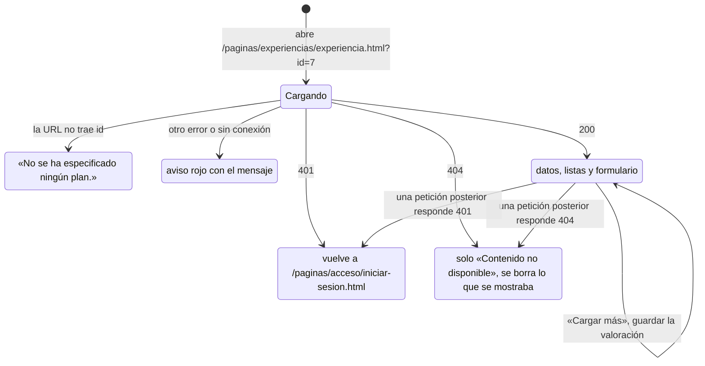
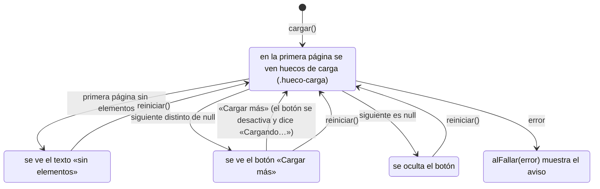

# Pantallas del frontend — PlanB

> Qué pantallas hay, cómo se pasa de una a otra, qué archivos usa cada una y qué llamadas hace a la API.
> Documentos relacionados: [arquitectura](arquitectura.md), [flujos](flujos.md), [referencia de la API](api.md), [glosario](anexo/glosario.md) e [inventario de pantallas](inventario-pantallas.md) (estados y lagunas frente al diseño).

El frontend son páginas HTML estáticas con JavaScript sin *framework* y estilos de Bootstrap 5 (solo su CSS, que carga `css/nucleo/tokens.css` en una capa) complementados por `css/nucleo/base.css`, `css/nucleo/componentes.css` y por el CSS propio de cada grupo de páginas. Está pensado para escritorio; la adaptación a pantallas pequeñas está aparcada. El mismo servidor Express sirve las páginas desde `frontend/` y la API desde `/api`, así que comparten origen y la cookie de sesión viaja sola en cada `fetch`.

## Mapa de navegación

El [sitemap de PlanB](sitemap.mmd) es la referencia del mapa de navegación, en formato Mermaid. Es la maqueta completa del rediseño: las doce páginas actuales y las que aún no existen, agrupadas en seis bloques y marcadas como «implementada», «a reorganizar» o «diseño futuro». Lo marcado «diseño futuro» o «a reorganizar» no existe todavía tal como se dibuja.

```mermaid
%% Copia renderizable de sitemap.mmd. Al modificar el sitemap, actualiza ambos bloques.
%% Sitemap de PlanB — rediseño (maqueta completa).
%% Cada caja es una página; las flechas, enlaces o redirecciones. Estado entre paréntesis: implementada, a reorganizar o diseño futuro.
%% Navegación principal (barra de pestañas): Inicio, Explorar, Mis planes y Amigos. Secundaria: menú de cuenta (Mi perfil, Guardados, Ajustes, Ayuda, Cerrar sesión), campana, «Crear plan», buscador y pie.
%% Línea discontinua: enlace recibido por correo. Sesión no válida (401) al cargar: se va a Iniciar sesión y, tras entrar, se vuelve a la misma pantalla (?volver=). Al guardar: aviso con enlace a Iniciar sesión en otra pestaña.
%% Los parámetros de las URL se explican en frontend.md.
flowchart TB
    subgraph g_0["Público"]
        index["Landing<br/>index.html<br/>(implementada)"]
        iniciar_sesion["Iniciar sesión<br/>/paginas/acceso/iniciar-sesion.html<br/>(implementada)"]
        registro["Crear cuenta<br/>/paginas/acceso/registro.html<br/>(implementada)"]
        recuperar["Recuperar contraseña<br/>/paginas/acceso/recuperar.html<br/>(implementada)"]
        restablecer["Restablecer contraseña<br/>/paginas/acceso/restablecer.html<br/>(implementada)"]
        ayuda["Ayuda<br/>ayuda.html<br/>(diseño futuro)"]
        terminos["Términos y privacidad<br/>terminos.html<br/>(diseño futuro)"]
        no_encontrada["Página no encontrada (404)<br/>no-encontrada.html<br/>(diseño futuro)"]
    end
    subgraph g_1["Inicio y descubrir"]
        bienvenida["Inicio<br/>/paginas/cuenta/bienvenida.html<br/>(implementada)"]
        explorar["Explorar<br/>explorar.html<br/>(implementada)"]
        ciudad["Ciudad<br/>ciudad.html?id=<br/>(diseño futuro)"]
    end
    subgraph g_2["Planes"]
        experiencia["Detalle del plan<br/>/paginas/experiencias/experiencia.html?id=<br/>(implementada)"]
        crear_plan["Crear plan<br/>crear-plan.html<br/>(a reorganizar)"]
        editar_plan["Editar plan<br/>editar-plan.html?id=<br/>(a reorganizar)"]
        guardados["Guardados<br/>guardados.html<br/>(diseño futuro)"]
        mis_planes["Mis planes<br/>mis-planes.html<br/>(implementada)"]
    end
    subgraph g_3["Personas y social"]
        perfil["Mi perfil<br/>/paginas/cuenta/perfil.html<br/>(a reorganizar)"]
        usuario["Perfil de otra persona<br/>/paginas/social/usuario.html?nombre=<br/>(implementada)"]
        amigos["Amigos<br/>amigos.html<br/>(implementada)"]
        seguidores["Seguidores y seguidos<br/>seguidores.html<br/>(diseño futuro)"]
    end
    subgraph g_4["Cuenta"]
        ajustes["Ajustes<br/>/paginas/cuenta/ajustes.html<br/>(a reorganizar)"]
    end
    subgraph g_5["Sistema"]
        notificaciones["Notificaciones<br/>notificaciones.html<br/>(diseño futuro)"]
        error["Error del servidor<br/>error.html<br/>(diseño futuro)"]
        sin_permiso["Sin permiso<br/>sin-permiso.html<br/>(diseño futuro)"]
    end

    nav["Barra de pestañas<br/>(con sesión)"]
    cuenta["Menú de cuenta<br/>(con sesión)"]
    pie["Pie<br/>(páginas públicas)"]

    index -->|"Iniciar sesión"| iniciar_sesion
    index -->|"Crear cuenta"| registro
    iniciar_sesion -->|"Crear cuenta"| registro
    registro -->|"Iniciar sesión"| iniciar_sesion
    iniciar_sesion -->|"¿Has olvidado tu contraseña?"| recuperar
    recuperar -->|"Volver"| iniciar_sesion
    recuperar -.->|"Enlace recibido por correo"| restablecer
    restablecer -->|"Volver tras cambiarla"| iniciar_sesion
    iniciar_sesion -->|"Acceso correcto"| bienvenida
    registro -->|"Cuenta creada"| bienvenida
    iniciar_sesion -->|"Logo"| index
    registro -->|"Logo"| index
    recuperar -->|"Logo"| index
    restablecer -->|"Logo"| index
    index -->|"Pie"| pie
    ayuda -->|"Pie"| pie
    terminos -->|"Pie"| pie
    pie -->|"Ayuda"| ayuda
    pie -->|"Términos y privacidad"| terminos
    nav -->|"Inicio"| bienvenida
    nav -->|"Explorar"| explorar
    nav -->|"Mis planes"| mis_planes
    nav -->|"Amigos"| amigos
    cuenta -->|"Mi perfil"| perfil
    cuenta -->|"Guardados"| guardados
    cuenta -->|"Ajustes"| ajustes
    cuenta -->|"Ayuda"| ayuda
    cuenta -->|"Cerrar sesión"| iniciar_sesion
    nav -->|"Campana"| notificaciones
    nav -->|"Crear plan"| crear_plan
    nav -->|"Buscador"| explorar
    bienvenida -->|"Tarjeta de plan"| experiencia
    explorar -->|"Una ciudad"| ciudad
    explorar -->|"Un plan"| experiencia
    ciudad -->|"Un plan"| experiencia
    explorar -->|"Una persona"| usuario
    explorar -->|"Un plan"| experiencia
    explorar -->|"Una ciudad"| ciudad
    mis_planes -->|"Un plan"| experiencia
    mis_planes -->|"Nuevo plan"| crear_plan
    guardados -->|"Un plan"| experiencia
    experiencia -->|"Editar (si soy el autor)"| editar_plan
    editar_plan -->|"Guardado o eliminado"| mis_planes
    crear_plan -->|"Publicado"| experiencia
    experiencia -->|"Autor o valoración"| usuario
    experiencia -->|"Si el autor soy yo"| perfil
    experiencia -->|"Ciudad"| ciudad
    perfil -->|"Mis planes"| mis_planes
    perfil -->|"Contador de amigos"| amigos
    perfil -->|"Contador de seguidores"| seguidores
    perfil -->|"Banda de solicitudes"| amigos
    perfil -->|"Editar perfil"| ajustes
    usuario -->|"Un plan suyo"| experiencia
    usuario -->|"Si es mi nombre"| perfil
    amigos -->|"Una persona"| usuario
    seguidores -->|"Una persona"| usuario
    amigos -->|"Solicitante"| usuario
    notificaciones -->|"Solicitud de amistad"| amigos
    notificaciones -->|"Valoración o plan"| experiencia
    notificaciones -->|"Nuevo seguidor"| usuario
    experiencia -->|"Contenido no visible"| sin_permiso
    usuario -->|"Usuario no existe"| no_encontrada
    bienvenida -->|"Fallo del servidor"| error
    ayuda -->|"Volver a la aplicación"| bienvenida
    error -->|"Ir al inicio"| bienvenida
    sin_permiso -->|"Ir al inicio"| bienvenida
    no_encontrada -->|"Ir al inicio"| bienvenida
    bienvenida -->|"Sesión no válida (401)"| iniciar_sesion
```

**Entrada:** `/` sirve `index.html`, la landing pública, con enlaces a `/paginas/acceso/iniciar-sesion.html` y `/paginas/acceso/registro.html`. Con la sesión ya iniciada, la landing lleva a `/paginas/cuenta/bienvenida.html` (`landing.js`); un inicio de sesión o un registro correctos también.

**Cabecera común:** las páginas con sesión (`bienvenida`, `explorar`, `mis-planes`, `amigos`, `perfil`, `ajustes`, `usuario` y `experiencia`) comparten `header.cabecera`: la marca PlanB, las pestañas «Inicio», «Explorar», «Mis planes» y «Amigos», un buscador, la campana de notificaciones y el menú de cuenta (ver «Cabecera común» más abajo).

**Sesión no válida:** si una página con sesión recibe 401, `irAlLogin` (en `js/shared/pantalla.js`) lleva a `/paginas/acceso/iniciar-sesion.html`. Si la carga falla por otro motivo, `alFallarCarga` deja a la persona en la página con un aviso y «Reintentar». Al volver con «atrás» a una pantalla que el navegador restaura tal cual, se recarga.

**Red lenta o caída:** una carga que falla no se muestra como vacía y ofrece «Reintentar» (la campana reintenta al abrirse). Mientras se envía una acción de amistad o seguimiento no se admite otra; el formulario de plan no se cierra mientras guarda; el de valoración no se puede usar hasta saber si ya hay una; «Nuevo plan» espera al catálogo de ciudades y opciones.

Las URL de detalle incluyen parámetros: `/paginas/social/usuario.html?nombre=...` identifica a la persona, `/paginas/experiencias/experiencia.html?id=...` la experiencia, `/paginas/experiencias/explorar.html?q=...` el texto a buscar y `/paginas/acceso/restablecer.html?token=...` recibe el código del enlace de recuperación. Un enlace a un usuario lleva a `/paginas/cuenta/perfil.html` si es el propio usuario y a `/paginas/social/usuario.html?nombre=...` si es otro: lo decide `crearEnlacePerfil`.

## Páginas, archivos y llamadas

Los HTML están en `paginas/<área>/` (`acceso`, `cuenta`, `experiencias`, `social`; `index.html` queda en la raíz), su script en `js/<área>/` con el mismo nombre, y los estilos en `css/nucleo/` (comunes) y `css/pantallas/` (propios). En las tablas siguientes se omiten esas carpetas.

Cada página carga primero `js/shared/api.js`, después los módulos compartidos que necesita y por último su script. Todas cargan `css/nucleo/tokens.css`, `base.css`, `componentes.css`, `cabecera.css` y `animaciones.css` (todos en `css/nucleo/`); la columna «CSS propio» es el segundo archivo de estilos.

| Página | Script | CSS propio | Módulos compartidos | Llamadas a la API | Historias |
|---|---|---|---|---|---|
| `index.html` | `landing/landing.js` | `landing.css` | `api`, `movimiento` | `GET /auth/yo` | CS-66 |
| `/paginas/acceso/iniciar-sesion.html` | `iniciar-sesion.js` | `acceso.css` | `api` | `POST /auth/login` | CS-59 |
| `/paginas/acceso/registro.html` | `registro.js` | `acceso.css` | `api`, `password` y Turnstile | `GET /auth/captcha`, `POST /auth/registro` | CS-59, CS-64 |
| `/paginas/acceso/recuperar.html` | `recuperar.js` | `acceso.css` | `api` | `POST /auth/recuperar` | CS-64 |
| `/paginas/acceso/restablecer.html` | `restablecer.js` | `acceso.css` | `api`, `password` | `POST /auth/restablecer` | CS-64 |
| `/paginas/cuenta/bienvenida.html` | `bienvenida.js` | `descubrir.css` | `api`, `pantalla`, `planes`, `cabecera` | `GET /auth/yo`, `GET /perfil`, `GET /ciudades`, `GET /experiencias` | CS-24, CS-25 |
| `/paginas/experiencias/explorar.html` | `explorar.js`, `social/personas.js` | `descubrir.css`, `buscar.css` | `api`, `pantalla`, `pestanas`, `planes`, `cabecera` | `GET /auth/yo`, `GET /experiencias/opciones`, `GET /ciudades`, `GET /perfil`, `GET /experiencias`, `GET /usuarios?texto=`, `POST` y `DELETE /amistades`, `PATCH /amistades/:id` | CS-10, CS-27, CS-61 |
| `/paginas/cuenta/mis-planes.html` | `mis-planes.js` | ninguno | `api`, `pantalla`, `planes`, `cabecera`, `lugares`, `mapa` (y Leaflet) | `GET /perfil`, `GET /ciudades`, `GET /experiencias/opciones`, `GET /experiencias?autor=`, `GET /experiencias/:id`, `GET /lugares/buscar`, `POST /experiencias`, `PATCH /experiencias/:id` | CS-44, CS-49, CS-50, CS-73, CS-57, CS-22, CS-55, CS-56 |
| `/paginas/cuenta/perfil.html` | `perfil.js` | `perfil.css` | `api`, `pantalla`, `pestanas`, `cabecera`, `planes`, `experiencias` | `GET /perfil`, `GET /perfil/resumen`, `/perfil/amigos`, `/perfil/seguidores` y `/perfil/seguidos`, `GET /experiencias?autor=` | CS-45, CS-44, CS-72 |
| `/paginas/cuenta/ajustes.html` | `ajustes.js` | ninguno | `api`, `pantalla`, `pestanas`, `cabecera`, `password`, `movimiento` | `GET` y `PUT /perfil`, `GET /ciudades`, `PUT /perfil/foto`, `PUT /perfil/password` | CS-47, CS-64 |
| `/paginas/social/amigos.html` | `social/amigos.js` | `perfil.css` | `api`, `pantalla`, `cabecera` | `GET /amistades/solicitudes`, `PATCH /amistades/:id`, `GET /perfil/amigos` | CS-61, CS-45 |
| `/paginas/social/usuario.html` | `usuario.js` | `perfil.css` | `api`, `pantalla`, `cabecera`, `planes`, `experiencias` | `GET /usuarios/:nombre`, `POST` y `DELETE /amistades`, `PATCH /amistades/:id`, `POST` y `DELETE /seguimientos`, `GET /experiencias?autor=` | CS-62, CS-61, CS-44 |
| `/paginas/experiencias/experiencia.html` | `experiencia.js` | `experiencia.css` | `api`, `pestanas`, `pantalla`, `cabecera`, `lugares`, `mapa` (y Leaflet) | `GET /experiencias/:id` (incluye lugares), `GET /auth/yo`, `GET /experiencias/:id/resumen`, `GET` y `PUT /experiencias/:id/valoracion`, `GET /experiencias/:id/valoraciones` y `/valoraciones/amigos` | CS-30, CS-63, CS-48, CS-01, CS-14, CS-50, CS-73 |

## Estilos

* Estilos comunes, en capas (`@layer sombras, bootstrap, tokens, base, componentes`, declaradas en `tokens.css`): `tokens.css` define las variables (`--color-*`, espaciado, anchos de contenido `--ancho-contenido` 960 px, `--ancho-lectura` 720 px y `--ancho-formulario` 400 px, radios, duraciones; `--color-lienzo` es el fondo de la página y las tarjetas y paneles son blancos con borde) e importa Bootstrap en la capa `bootstrap`; `base.css` lleva el fondo, el `body` y los encabezados; `componentes.css` los componentes compartidos (botones, tarjetas, avisos, el enlace «Saltar al contenido»); `cabecera.css` la cabecera (en una sola línea, con el buscador flexible entre 160 y 280 px, pegajosa y con la campana); `animaciones.css` los *keyframes* y las transiciones de botones y tarjetas. El CSS propio de cada página no lleva capa y por eso gana a todo lo anterior.
* Movimiento: las entradas duran entre 100 y 400 ms con `ease-out` y animan solo `transform` y `opacity`. Las animaciones que no terminan (fondo, ilustraciones, landing) se detienen solas a los 5 s poniendo `data-movimiento="pausado"` en `<html>`; en Ajustes se puede dejarlas pausadas o fijas. Con `prefers-reduced-motion` la página arranca ya pausada.
* `landing.css`: la landing (`index.html`).
* Tarjetas de experiencia: bloque de color con icono (`.bloque-categoria`, color según `data-categoria`). Estados vacíos: `.estado-vacio` con ilustración animada de `img/vacio-*.svg` (mancha de color, objeto con microanimación; decorativa y sin movimiento con `prefers-reduced-motion`).
* `acceso.css`: la tarjeta de formulario de `iniciar-sesion`, `registro`, `recuperar` y `restablecer`. La columna de marca usa como fondo la escena animada `img/escena-acceso.svg` (puesta en `acceso.css`).
* `experiencia.css`: el detalle de experiencia, con la experiencia y el formulario en una columna y las valoraciones en otra.
* `perfil.css`: `/paginas/cuenta/perfil.html` y `/paginas/social/usuario.html`.
* `ajustes.css`: `/paginas/cuenta/ajustes.html`. `formulario-plan.css`: el formulario de `/paginas/cuenta/mis-planes.html`.
* `buscar.css`: la pestaña «Personas» de Explorar.

## Estados de una pantalla

Casi todas las pantallas con datos pasan por los mismos estados. Este es el de `/paginas/experiencias/experiencia.html`, el más completo; `/paginas/social/usuario.html` es igual, pero el aviso que muestra es «Usuario no encontrado».

Cada lista con «Cargar más» tiene, a su vez, sus propios estados, que gestiona `listaConCargarMas`:

## Cabecera común

Las páginas con sesión llevan `header.cabecera`, con el mismo HTML en todas:

* La marca PlanB y los enlaces «Inicio», «Explorar», «Mis planes» y «Amigos», dentro de un `nav` con `aria-label="Principal"`; en la página actual el enlace lleva `aria-current="page"`.
* Un buscador de planes y personas (`form[role="search"]`, píldora con el botón relleno encajado) que envía a `/paginas/experiencias/explorar.html?q=`. No se envía si el texto está vacío.
* La campana, un `
` con el contador `#contador-notificaciones`, la lista `#lista-notificaciones` (una por solicitud de amistad pendiente, de `GET /api/amistades/solicitudes`; el nombre lleva al perfil de quien la envía y «Aceptar» y «Rechazar» la responden ahí mismo, con mensaje de resultado, foco en él y contador actualizado), `#sin-notificaciones` (dice «Cargando…», que no hay nada nuevo o que no se han podido cargar) y el enlace «Ver amigos y solicitudes» a `/paginas/social/amigos.html`. Se cierra con clic fuera o Escape.
* El menú de cuenta, un `
` cuyo resumen lleva el avatar (`img.menu-avatar`, 32 px: la foto del usuario que `cabecera.js` pide a `/api/perfil`, o la foto por defecto) y que contiene «Mi perfil», «Ajustes» y el botón «Cerrar sesión» (`data-cerrar-sesion`). Se cierra al hacer clic fuera, al pulsar Escape (el foco vuelve al resumen) y al elegir una opción, salvo «Cerrar sesión», que deja ver la espera.

`js/shared/cabecera.js` engancha esos comportamientos. «Cerrar sesión» llama a `POST /api/auth/logout` y va a `/paginas/acceso/iniciar-sesion.html`; mientras espera, el botón se desactiva y muestra «Cerrando sesión…», y si falla se restaura y aparece un aviso `role="alert"` bajo la cabecera.

Antes de la cabecera, cada una de estas páginas (y la landing) lleva el enlace «Saltar al contenido», que solo se ve al recibir el foco del teclado.

## Cada página

### `index.html`: landing

Página pública y estática: su único JavaScript es el botón de pausa del movimiento (`shared/movimiento.js`); no comprueba la sesión y no llama a la API. Su cabecera solo ofrece «Iniciar sesión» y «Crear cuenta». Presenta la frase «Comparte y descubre planes por tu ciudad» con una ilustración rodeada de pegatinas, las categorías, tres bloques de valor, los tres pasos de uso (cada uno con su dibujo SVG) y una banda de cierre con onda con los dos accesos. Es la página que sirve `/`. Lleva una capa decorativa de movimiento solo con CSS (ruta que se dibuja con el scroll, manchas y pines flotantes), descrita en `arte.md`.

Pruebas: `landing.test.js`.

### `/paginas/acceso/iniciar-sesion.html`: iniciar sesión

Formulario de email y contraseña. Si el login es correcto va a `/paginas/cuenta/bienvenida.html`; si no, muestra el mensaje del servidor en `#error-login`. Enlaza a la recuperación de la contraseña y ofrece «Crear cuenta».

Pruebas: `iniciar-sesion.test.js`.

### `/paginas/acceso/registro.html`: crear una cuenta

* Pide nombre de usuario, email y contraseña. Mientras se escribe la contraseña, `mostrarRequisitosPassword` marca cada requisito cumplido en `#requisitos-password`, también el de no contener el nombre; cada uno lleva el estado también como texto oculto («cumplido» o «pendiente»), no solo con el símbolo.
* El formulario es `novalidate`: al salir de nombre, email o contraseña vacíos (o con email sin formato) aparece el mensaje en español en `#mensaje-<campo>` (`.mensaje-campo`) y el campo lleva `aria-invalid`. Al enviar con errores no se llama al servidor, se marcan todos, el foco va al primero y `#error-registro` dice «Revisa los campos marcados.».
* El CAPTCHA de Cloudflare Turnstile se dibuja en `#captcha` cuando su script llama a `window.iniciarCaptcha`, con la clave pública de `GET /api/auth/captcha`.
* Con el registro correcto, la sesión ya está abierta y va a `/paginas/cuenta/bienvenida.html`.

Pruebas: `registro.test.js`.

### `/paginas/acceso/recuperar.html`: pedir el enlace

Pide el email y siempre muestra el mismo mensaje de éxito, exista la cuenta o no: la página no lo sabe, y así nadie puede usarla para averiguarlo.

Pruebas: `recuperacion.test.js`.

### `/paginas/acceso/restablecer.html`: elegir una contraseña nueva

* Lee el `token` de la URL. Sin token muestra el aviso, con un enlace «Pide uno nuevo» a `/paginas/acceso/recuperar.html`, y oculta el formulario.
* Pide la contraseña dos veces y comprueba en la pantalla que coinciden antes de enviarla. El requisito «sin el nombre de usuario» lo comprueba el servidor, porque la página no sabe de quién es el enlace.
* Al terminar, muestra un enlace a `/paginas/acceso/iniciar-sesion.html`.

Pruebas: `recuperacion.test.js`.

### `/paginas/cuenta/bienvenida.html`: inicio

* Portada con «Hola, <nombre>» y «Nuevo plan» (a `/paginas/cuenta/mis-planes.html?nuevo=1`), y debajo tiras horizontales de planes (`#tiras`): «Planes en mi ciudad» (con la ciudad del perfil debajo), «Planes nuevos» y «Lo que hacen tus amigos». Cada una lleva «Ver más →» a `/paginas/experiencias/explorar.html?tira=<id>`. La fila de tarjetas es un grupo enfocable con Tab (`tabindex="0"`, `role="group"`, nombrado por el título de la tira) para poder desplazarla con las flechas.
* Cada tira pide hasta 8 planes a `GET /api/experiencias`: la de la ciudad con `ciudadId` (la ciudad del perfil es texto libre y se busca por nombre en `GET /ciudades`, sin distinguir mayúsculas ni acentos), «Planes nuevos» sin filtros y la de amigos con `amigos=true`. Los encabezados se pintan al abrir, con huecos de carga, y cada tira se rellena cuando llega lo suyo. Una tira sin planes, o sin ciudad en el catálogo, muestra un aviso (`.tira-vacia`); si su petición falla, lo dice con «Reintentar» y las demás siguen.
* Las tarjetas son las comunes de los planes (`crearTarjetaPlan`, `js/shared/planes.js`): se pulsan enteras, porque el enlace del título las cubre, y muestran ciudad, categoría, duración, tarifa, descripción y autor. En «Mis planes» y en los perfiles llevan además la etiqueta de visibilidad, y en «Mis planes», «Editar».

Pruebas: `inicio.test.js`.

### `/paginas/experiencias/explorar.html`: explorar

* Planes reales de `GET /api/experiencias`, de 12 en 12 con «Cargar más» (`#mas-planes`). Filtros: categoría (botones con `aria-pressed`, de `GET /experiencias/opciones`), momento adecuado (`#filtro-momento`), ciudad (`#filtro-ciudad`), presupuesto máximo en euros (`#filtro-tarifa`) y duración máxima en minutos (`#filtro-duracion`; los planes sin ese dato no aparecen), valoración mínima sobre la media (`#filtro-minimo`; los planes sin valoraciones no la alcanzan) y «solo planes de mis amigos» (`#filtro-amigos`); cada cambio vuelve a pedir la primera página y queda en la URL; al volver o recargar se recuperan los filtros, y al volver también las tarjetas cargadas y la posición. Al abrir, los planes se piden a la vez que los filtros, salvo que haga falta alguna opción (categoría, momento o ciudad en la URL, o `?tira=ciudad`). `#total-planes` cuenta los cargados («o más» si hay otra página); `#sin-resultados` si no hay ninguno; `#error-planes` con «Reintentar» si falla.
* `?tira=` pone el título de la tira de origen y deja puestos sus filtros (`ciudad`: la ciudad del perfil, y si no está en el catálogo el subtítulo lo dice y se ven todas; `amigos`: solo amigos). «Limpiar filtros» (`#limpiar-filtros`) aparece cuando hay alguno puesto. Con una ciudad elegida, y sin `?tira=` ni búsqueda, el título es «Planes en <ciudad>»; así se abre con `?ciudad=<id>`. Si esa ciudad es el único filtro y no tiene planes, `#sin-resultados` dice «Todavía no hay planes en <ciudad>.»; si no está en el catálogo, no se piden planes, lo dice y aparece «Limpiar filtros».
* Es también la pantalla de resultados del buscador de la cabecera (`?q=`): rellena ese campo, `#busqueda-activa` dice qué se ha buscado y ofrece «Quitar búsqueda», y los planes se filtran por el texto. Dos pestañas (`shared/pestanas.js`), «Planes» y «Personas», que con texto llevan el número de resultados («Planes (12+)», «Personas (3)»); si no hay planes y sí personas se abre «Personas».
* **Personas** (`social/personas.js`): busca por parte del nombre con `GET /api/usuarios?texto=` (como mucho 20, «20+»). Cada fila (`.fila-resultado`) lleva un enlace a su perfil con foto, nombre y ciudad y, a la derecha, la relación con quien busca («Amigos», «Solicitud enviada», «Te ha enviado una solicitud», «Le sigues») y sus botones: el de amistad («Añadir amigo», «Cancelar solicitud» o «Aceptar» y «Rechazar»; un amigo no lleva) y «Seguir» o «Dejar de seguir». Toda la fila abre el perfil. Tras una acción la fila cambia sin recargar; si falla, muestra el error en la propia fila y, si la relación había cambiado (400 o 404), la vuelve a pedir. Si falla la búsqueda, `#error-personas` ofrece «Reintentar». Sin texto, `#ayuda-personas` remite al buscador. `?pestana=pestana-personas` abre esta pestaña.

Pruebas: `explorar.test.js`, `personas.test.js` y `pestanas.test.js`.

### `/paginas/cuenta/mis-planes.html`: mis planes

* Muestra las experiencias del usuario en una rejilla, de 10 en 10, con «Cargar más» (`#mas-experiencias`). Mientras llegan los datos se ve «Cargando…» (`#cargando`) y, si no hay ninguna experiencia, `#sin-experiencias` dice «Todavía no has publicado planes.» junto a la tarjeta «+».
* La primera tarjeta, «+», abre el `<dialog>` `#dialogo-experiencia` para crear una experiencia. «Editar» abre el mismo diálogo relleno con sus datos.
* El diálogo tiene dos columnas: los campos a la izquierda y, a la derecha, `#vista-previa` con la tarjeta tal como quedará (la misma, sin enlace ni «Editar»), que cambia al escribir. Campos, en orden:
  * Título.
  * Categoría: una pastilla de radio por cada categoría de `GET /api/experiencias/opciones`, con su icono y color; obligatoria.
  * Ciudad: campo de texto con `<datalist>` (`#lista-ciudades`) que sugiere primero la ciudad del perfil (`GET /api/perfil`, si coincide con una del catálogo), después las de mis experiencias y luego el resto. Al crear se propone la del perfil. Si lo escrito no es una ciudad del catálogo, `#mensaje-ciudad` dice «Elige una ciudad de la lista.» y no se envía nada.
  * Descripción, con una pista de qué contar y un contador de caracteres (`#contador-descripcion`).
  * Momento adecuado (opcional): «Sin indicar» y pastillas agrupadas por franja del día, día de la semana y estación.
  * Duración en minutos y tarifa en euros (CS-53, opcionales; `#duracion-minutos`, `#tarifa`): vacío = sin especificar.
  * Lugares (CS-50, opcionales): buscador (`#buscar-lugar`; Intro o «Buscar» buscan en la ciudad del plan) con las fichas encontradas en `#resultados-lugares` y «Añadir». Los elegidos (`#lugares-elegidos`, máximo 20) llevan nota opcional de hasta 300 caracteres y «Subir», «Bajar» y «Quitar». `#mensaje-lugares` (`role="status"`) anuncia el resultado. Con lugares de otra ciudad no se busca ni se guarda hasta quitarlos o volver a ella. Se envían en `lugares` al crear (si hay alguno) y al editar; si al editar no se pueden cargar, el buscador se desactiva y no se envían.
  * Mapa (CS-73, `#mapa-lugares`): los lugares elegidos y, atenuados, los resultados sin elegir; pulsar un resultado en el mapa lo marca en la lista y lleva el foco a «Añadir». Sin resultados ni elegidos no se muestra.
  * Quién la verá: tres tarjetas de radio (Pública, Amigos, Privada) con icono y quién la verá; Pública por defecto.
* El botón dice «Publicar plan» al crear y «Guardar cambios» al editar.
* Cancelar o Esc con cambios sin guardar abren `#dialogo-descartar` («Seguir editando» o «Descartar»); sin cambios, cierran. Enter en un campo corto no publica, Escape pasa siempre por esa pregunta y salir de la página con cambios pide confirmación.
* `?nuevo=1` abre el diálogo de creación y `?editar=<id>` el de edición de esa experiencia; el botón «Editar plan» del detalle usa este último. La dirección se limpia al abrirlo. Desde `?editar=`, guardar o cancelar vuelven al detalle de la experiencia.
* Al guardar, la tarjeta nueva aparece la primera y la editada se sustituye en su sitio, sin recargar la página. Tras guardar, `#aviso-creada` dice «Plan publicado.» o «Cambios guardados.» con el enlace «Ver plan», que recibe el foco, y un botón para cerrarlo. Mientras se guarda, «Cancelar» está desactivado. En el detalle, guardar una valoración muestra «Valoración guardada.» bajo el botón, y al volver de editar aparece «Cambios guardados.». `?editar=` no abre planes de otro usuario. La ficha del detalle ofrece «Valorar» a quien no es el autor; «Copiar enlace» dice quién puede abrir un plan no público y, si no puede copiar, muestra la dirección. «← Volver» está también cuando el plan no se puede mostrar.

Pruebas: `mis-planes.test.js`, `mis-planes.formulario.test.js`, `cs50LugaresFormulario.test.js`, `cs73Mapa.test.js` y `estados.test.js`.

### `/paginas/cuenta/perfil.html`: mi perfil

* **Cabecera:** foto, nombre, ciudad (`#ciudad-perfil`), contadores de experiencias, amigos, seguidores y personas a las que sigue («siguiendo», CS-72), y el botón «Editar perfil», que lleva a los ajustes. Hasta que llegan los datos se ve «Cargando…» (`#cargando`) y los contadores muestran «–».
* **Pestañas** (`shared/pestanas.js`): *Experiencias* (con `mostrarExperienciasDe`, incluidas las privadas), *Amigos*, *Seguidores* y *Siguiendo* (CS-72) (listas de 20 en 20 con «Cargar más»; cada nombre lleva a su perfil). Quien no sigue a nadie ve un aviso con un enlace para buscar personas.

Pruebas: `perfil.relaciones.test.js`, `perfil.seguidos.test.js`, `perfil.cabecera.test.js`, `estados.test.js` y `shared/experiencias.test.js`.

### `/paginas/cuenta/ajustes.html`: ajustes

Dos pestañas (`shared/pestanas.js`); «Cerrar sesión» está solo en el menú de la cuenta:

* **Perfil:** los campos y la foto están desactivados hasta que llega el perfil. La foto es un avatar grande clicable con icono de cámara (el `input` de archivo va oculto y la etiqueta lo abre); se sube nada más elegirla. La ciudad es texto libre con las ciudades del catálogo (`GET /ciudades`) como sugerencias (`datalist`) y se guarda sola al salir del campo: `#estado-guardado` (`role="status"`) muestra «Guardando…» y «Guardado», y los errores salen en `#error-perfil`. El nombre de usuario, que es la dirección del perfil, no se guarda solo: al editarlo aparece «Cambiar nombre» (`#cambiar-nombre`) y solo ese botón lo envía. Los envíos se serializan. El email es solo de lectura y explica por qué. El interruptor «Pausar las animaciones del fondo» (`#pausar-animaciones`) guarda la preferencia de movimiento.
* **Contraseña:** aviso de que se seguirá con la sesión iniciada en este y otros dispositivos; actual, nueva y repetida, con la lista de requisitos visible desde el principio (✓ y verde al cumplirse).

Pruebas: `ajustes.test.js`, `ajustes.foto.test.js`, `ajustes.password.test.js` y `estados.test.js`.

### `/paginas/social/amigos.html`: amigos y solicitudes

Arriba, las solicitudes recibidas, cada una con «Aceptar» y «Rechazar»; si no hay ninguna se ve «No tienes solicitudes pendientes.». Al responder, la fila pasa a un mensaje («Ahora sois amigos de X» con «Ver perfil», o «Solicitud rechazada: X») que recibe el foco. Los botones de amistad de todas las pantallas salen de `crearBotonesAmistad`. Si una de las dos listas falla, su aviso ofrece «Reintentar». Debajo, «Tus amigos» (`#lista-amigos`, de `GET /api/perfil/amigos`, con «Cargar más») que se actualiza al aceptar. Si la solicitud ya no se puede responder (400 o 404), la lista se vuelve a pedir y la campana la marca con el motivo. La campana, esta página y el perfil de otro usuario se enteran con el evento `solicitud-respondida` (`detail.id`, `detail.aceptada`).

Se llega desde la pestaña «Amigos» o desde la campana de la cabecera. Pruebas: `amigos.test.js` y `estados.test.js`.

### `/paginas/social/usuario.html?nombre=`: perfil de otro usuario

* El perfil y «Sus planes» se piden a la vez.
* Foto, nombre, ciudad y contadores de amigos y seguidores. Hasta que llega el perfil se ve «Cargando…» (`#cargando`) y no los datos de relleno. Si el usuario no existe, solo se muestra `#no-encontrado`; si es el propio usuario, va a `/paginas/cuenta/perfil.html`.
* En `#botones-amistad` aparecen los botones que corresponden a la relación (ver [E2](flujos.md#e2-la-relación-vista-desde-el-perfil-de-otro-usuario)). «Eliminar amigo» pide confirmación en un `<dialog>` (`#dialogo-eliminar-amigo`) y «Cancelar solicitud» borra la solicitud enviada.
* `#boton-seguir` alterna entre «Seguir» y «Dejar de seguir».
* Tras cada acción se vuelve a pedir el perfil, para que los contadores y botones sean los reales, y también «Sus planes», porque al cambiar la amistad cambian las que se pueden ver.

Pruebas: `usuario.test.js`, `estados.test.js`, `usuario.cabecera.test.js` y `shared/experiencias.test.js`.

### `/paginas/experiencias/experiencia.html?id=`: una experiencia

* Dos columnas: a la izquierda título, descripción, resumen, «Tu valoración», las listas y el formulario, en ese orden; a la derecha la ficha (`aside.ficha-experiencia`, fija al desplazar): bloque de color de la categoría, autor (enlace a su perfil), ciudad (enlace a sus planes en Explorar, CS-74), categoría, momento (oculto si no se indicó), duración y tarifa (CS-53, ocultas si no se indicaron), visibilidad y, solo para el autor, «Editar plan».
* **«← Volver»** (`#enlace-volver`) lleva a la pantalla de PlanB desde la que se llegó, con su búsqueda (`document.referrer`, que Helmet solo envía dentro del mismo origen); sin ella, a Inicio. Si se llegó desde PlanB, retrocede en el historial.
* **Lugares** (CS-50, `#seccion-lugares`, debajo de la descripción): una ficha por lugar en el orden del autor, con su nota. Sin lugares no aparece; si no se pueden cargar, dice «No se han podido cargar los lugares.» y el resto de la página sigue igual.
* **Mapa** (CS-73, `#mapa-lugares`, encima de las fichas): un marcador por lugar; al pulsarlo se ve su nombre.
* **Resumen** (CS-14, `#resumen-valoraciones`): media con coma decimal y en estrellas, número de valoraciones y de comentarios, y una barra por puntuación de 5 a 1. Sin valoraciones dice «Todavía sin valoraciones.»; si no se puede cargar, se oculta y el resto de la página sigue igual.
* **Tu valoración** (`#mi-valoracion`): si ya la había valorado, mis estrellas y mi comentario encima de las listas, con un enlace «Cambiar» al formulario. Al publicar se actualizan al momento, junto con el resumen y la lista «Todas».
* **Valorar:** el formulario va al final, solo aparece si no soy el autor y se rellena con mi valoración si ya la había hecho. La puntuación es obligatoria y se elige con cinco estrellas (`role="radiogroup"`, con las flechas se mueve y elige entre ellas y solo la elegida entra en el orden de Tab; el valor va en el campo oculto `#val-puntuacion`); las valoraciones publicadas la muestran con estrellas rellenas (`.estrellas`, `aria-label="n de 5"`). `#contador-caracteres` cuenta hasta 1000. El botón «Publicar valoración» pasa a «Actualizar valoración» cuando ya existe una.
* **Valoraciones de amigos y seguidores** (CS-48) y **todas las valoraciones** (CS-63): dos pestañas de 10 en 10 con «Cargar más». Se abre la de amigos, salvo que esté vacía y «Todas» no; las listas no se ven hasta decidirlo, y el resumen reserva un hueco mientras llega.
* **«Útil» y «Reportar»:** no guardan nada hasta que se implementen CS-02 y CS-04: «Útil» está desactivado, con el motivo al lado, y «Reportar» abre el `<dialog>` `#dialogo-reporte`, que al enviar avisa de que todavía no se puede.
* Si cualquier petición responde 404, se borra lo que se mostraba y queda solo «Contenido no disponible».

Pruebas: `experiencia.test.js`, `experiencia.formulario.test.js`, `cs50LugaresDetalle.test.js` y `cs73Mapa.test.js`.

## Módulos compartidos (`js/shared/`)

| Archivo | Ofrece | Lo usan |
|---|---|---|
| `api.js` | `api(ruta, opciones)`: llama a `/api` + `ruta` con `fetch` y la cookie de sesión. Envía `Content-Type: application/json` salvo con `FormData`, en cuyo caso la cabecera la pone el navegador. Devuelve el JSON (o `null` si no hay cuerpo); si falla, lanza un `Error` con el mensaje del servidor y `error.status`. Corta la petición a los 30 segundos (120 con `FormData`) y, si era una escritura, avisa de que puede haberse guardado. Los GET iguales que coinciden en el tiempo comparten una petición; cualquier escritura la olvida. | Todas las páginas |
| `pantalla.js` | `mostrarMensaje(caja, texto)` y `ocultarMensaje(caja)`; `mostrarErrorConReintento(caja, texto, reintentar)`, que añade al aviso un botón «Reintentar» (lo usan Mis planes y el listado de experiencias del perfil, y `listaConCargarMas` se lo pasa a `alFallar`); `mostrarCargando()` y `ocultarCargando()`, que muestran y ocultan el texto `#cargando` de la página; `irAlLogin()`; `crearBotonesAmistad(amistad, alPulsar)` (los botones de cada relación); `crearHuecoCarga()` (hueco que late mientras llega un elemento); `alFallarCarga(err, reintentar)` (login solo con 401; si no, aviso con «Reintentar»); `crearEnlacePerfil(enlace, usuario, miUsuarioId)`; `crearBloqueCategoria(tipo)`, que devuelve el bloque de color con el icono de la categoría deducida de `tipo` (texto libre; «rincones» si no encaja ninguna); `listaConCargarMas({ lista, vacio, botonMas, pedir, crear, alFallar, alPintar })`, que devuelve `{ cargar, reiniciar }` y no repite un elemento que ya está en la lista. La lista está vacía cuando no tiene ningún hijo con `data-id-elemento`, de modo que la tarjeta «+» de la bienvenida no cuenta. | Las páginas con sesión y `experiencias.js` (la página de una experiencia también usa `crearBloqueCategoria` en su cabecera) |
| `lugares.js` | `buscarLugares(texto, ciudad)` consulta `GET /lugares/buscar`; `lugaresDe(experiencia)` lee sus lugares persistidos en orden; `crearFichaLugar(lugar)` muestra imagen, nombre, tipo, dirección y web si es HTTP(S). | `mis-planes.js`, `experiencia.js` |
| `mapa.js` | `crearMapaLugares(contenedor)`: mapa de Leaflet (`/vendor/leaflet/`) con fondo de OpenStreetMap, al que solo se envía el origen como referencia. `mostrar(puntos)` pone un marcador por lugar y oculta el mapa si no hay ninguno. Sin Leaflet dice «El mapa no está disponible.» y, si falla el fondo, «No se ha podido cargar el fondo del mapa.» | `mis-planes.js`, `experiencia.js` |
| `experiencias.js` | `mostrarExperienciasDe(nombreUsuario)` y `recargarExperiencias()`: la lista «Cargar más» de experiencias de un autor. La página debe tener `#lista-experiencias`, `#sin-experiencias`, `#mas-experiencias` y `#error-experiencias`. | `perfil.js`, `usuario.js` |
| `movimiento.js` | Pone `data-movimiento="pausado"` en `<html>` a los 5 s, o al cargar si la persona lo pausó o el sistema pide reducir el movimiento. Expone `fijarMovimiento(pausado)` (aplica y guarda en `localStorage`) y `movimientoPausado()`. | Todas las páginas |
| `cabecera.js` | Comportamiento de la cabecera común (ver «Cabecera común»). No exporta nada. | Las páginas con sesión |
| `pestanas.js` | `window.activarPestanas(lista)`: pestañas accesibles (`role="tablist"`) que se manejan con ratón y teclado; la elegida queda en la URL (`?pestana=`). | `explorar.js`, `experiencia.js`, `perfil.js`, `ajustes.js` |
| `password.js` | `mostrarRequisitosPassword(campo, lista, obtenerNombre)`: marca los requisitos cumplidos mientras se escribe. Son los mismos que comprueba el backend, que es quien decide. | `registro.js`, `ajustes.js`, `restablecer.js` |

Los módulos se cargan con `<script>` normales (no son módulos ES) y exponen sus funciones con `window.nombre = nombre`, para que se vea qué ofrece cada archivo y las pruebas puedan cargarlos.

## Reglas del frontend

* **Sin scripts en línea.** La política CSP de Helmet los bloquea: nada de `onclick=` ni `<script>` con código dentro del HTML. Los eventos se asignan con `addEventListener` en el JS de la página.
* **Avisos de error con `role="alert"`.** Todo elemento cuyo `id` empieza por `error-` lleva `role="alert"` para que se anuncie a los lectores de pantalla; `estados.test.js` lo comprueba en las páginas con avisos de error.
* **Texto de usuarios con `textContent`.** Nunca con `innerHTML`, para que un nombre o comentario con HTML se vea como texto y no se ejecute. `innerHTML` solo se usa para estructuras fijas sin datos, como el esqueleto de una tarjeta.
* **Ventanas con `<dialog>`.** La CSP no deja cargar el JavaScript de Bootstrap desde el CDN, así que los diálogos usan el elemento nativo `<dialog>` con `showModal()` y `close()`.
* **La seguridad está en el backend.** Ocultar un botón (por ejemplo, el formulario de valorar en una experiencia propia) solo mejora la interfaz: el servidor comprueba siempre los permisos.
* **Llamadas con `api`.** Las páginas usan `shared/api.js` para todas las peticiones HTTP; el frontend no lee ficheros de lugares.
* **Colores en variables.** Los colores solo se definen como variables en `css/nucleo/tokens.css`; los demás CSS las usan.
* **Escritorio.** El diseño se comprueba en escritorio.

## Pruebas del frontend

Las pruebas están en `backend/tests/frontend/`, agrupadas por página y tema (`ajustes.foto.test.js`, `ajustes.password.test.js`...), y en `backend/tests/frontend/shared/`. `cabecera.test.js` y `enlaces.test.js` comprueban la cabecera común y los enlaces entre páginas. Usan Jest con jsdom: cargan el HTML real de la página, simulan `fetch` y comprueban lo que ve el usuario. El ayudante `tests/helpers/pantalla.js` carga los scripts en orden, igual que el navegador. Se ejecutan con el resto: `npm test` desde `backend/`.
