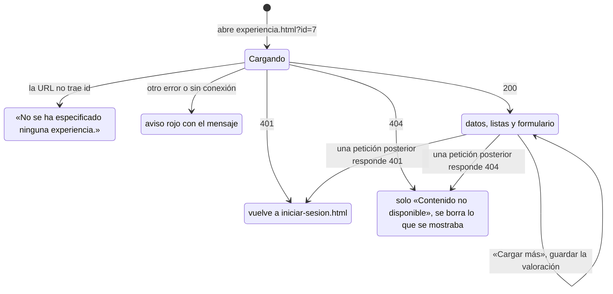
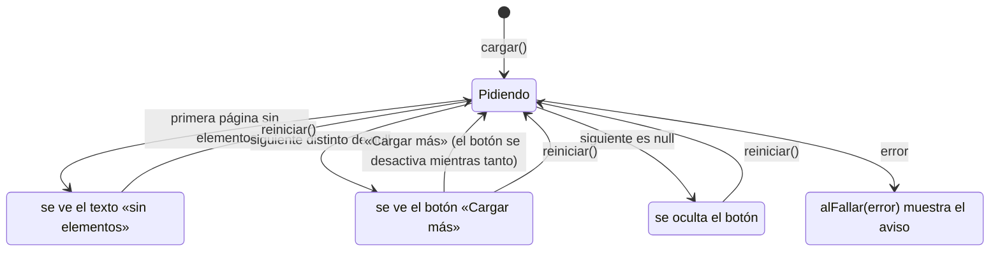

# Pantallas del frontend — PlanB

> Qué pantallas hay, cómo se pasa de una a otra, qué archivos usa cada una y qué llamadas hace a la API.
> Documentos relacionados: [arquitectura](arquitectura.md), [flujos](flujos.md), [referencia de la API](api.md), [glosario](anexo/glosario.md) e [inventario de pantallas](inventario-pantallas.md) (estados y lagunas frente al diseño).

El frontend son páginas HTML estáticas con JavaScript sin *framework* y estilos de Bootstrap 5 (solo su CSS) complementados por `css/styles.css` y por el CSS propio de cada grupo de páginas. Está pensado para escritorio; la adaptación a pantallas pequeñas está aparcada. El mismo servidor Express sirve las páginas desde `frontend/` y la API desde `/api`, así que comparten origen y la cookie de sesión viaja sola en cada `fetch`.

## Mapa de navegación

El [sitemap de PlanB](sitemap.mmd) es la referencia del mapa de navegación, en formato Mermaid. Contiene las doce páginas actuales, agrupadas en «Acceso» y «Con sesión».

**Entrada:** `/` sirve `index.html`, la landing pública, con enlaces a `iniciar-sesion.html` y `registro.html`. Un inicio de sesión o un registro correctos llevan a `bienvenida.html`.

**Cabecera común:** las siete páginas con sesión (`bienvenida`, `perfil`, `ajustes`, `solicitudes`, `personas`, `usuario` y `experiencia`) comparten `header.cabecera`: la marca PlanB, «Inicio» (a `bienvenida.html`) y «Solicitudes» (a `solicitudes.html`), un buscador y el menú de cuenta (ver «Cabecera común» más abajo).

**Sesión no válida:** si una página con sesión recibe 401, `irAlLogin` (en `js/shared/pantalla.js`) lleva a `iniciar-sesion.html`.

Las URL de detalle incluyen parámetros: `usuario.html?nombre=...` identifica a la persona, `experiencia.html?id=...` la experiencia, `personas.html?q=...` el texto a buscar y `restablecer.html?token=...` recibe el código del enlace de recuperación. Un enlace a un usuario lleva a `perfil.html` si es el propio usuario y a `usuario.html?nombre=...` si es otro: lo decide `crearEnlacePerfil`.

## Páginas, archivos y llamadas

Cada página carga primero `js/shared/api.js`, después los módulos compartidos que necesita y por último su script. Todas cargan `css/styles.css`; la columna «CSS propio» es el segundo archivo de estilos.

| Página | Script | CSS propio | Módulos compartidos | Llamadas a la API | Historias |
|---|---|---|---|---|---|
| `index.html` | ninguno | `landing.css` | ninguno | ninguna | CS-66 |
| `iniciar-sesion.html` | `iniciar-sesion.js` | `acceso.css` | `api` | `POST /auth/login` | CS-59 |
| `registro.html` | `registro.js` | `acceso.css` | `api`, `password` y Turnstile | `GET /auth/captcha`, `POST /auth/registro` | CS-59, CS-64 |
| `recuperar.html` | `recuperar.js` | `acceso.css` | `api` | `POST /auth/recuperar` | CS-64 |
| `restablecer.html` | `restablecer.js` | `acceso.css` | `api`, `password` | `POST /auth/restablecer` | CS-64 |
| `bienvenida.html` | `bienvenida.js` | ninguno | `api`, `pantalla`, `cabecera` | `GET /auth/yo`, `GET /ciudades`, `GET /experiencias?autor=`, `POST /experiencias`, `PATCH /experiencias/:id` | CS-44, CS-49, CS-57, CS-22 |
| `perfil.html` | `perfil.js` | `perfil.css` | `api`, `pantalla`, `pestanas`, `cabecera`, `experiencias` | `GET /perfil`, `GET /perfil/resumen`, `/perfil/amigos` y `/perfil/seguidores`, `GET /experiencias?autor=` | CS-45, CS-44 |
| `ajustes.html` | `ajustes.js` | ninguno | `api`, `pantalla`, `pestanas`, `cabecera`, `password` | `GET` y `PUT /perfil`, `PUT /perfil/foto`, `PUT /perfil/password` | CS-47, CS-64 |
| `solicitudes.html` | `solicitudes.js` | ninguno | `api`, `pantalla`, `cabecera` | `GET /amistades/solicitudes`, `PATCH /amistades/:id` | CS-61 |
| `personas.html` | `personas.js` | `buscar.css` | `api`, `pantalla`, `pestanas`, `cabecera` | `GET /usuarios?texto=` | CS-61 |
| `usuario.html` | `usuario.js` | `perfil.css` | `api`, `pantalla`, `cabecera`, `experiencias` | `GET /usuarios/:nombre`, `POST` y `DELETE /amistades`, `PATCH /amistades/:id`, `POST` y `DELETE /seguimientos`, `GET /experiencias?autor=` | CS-62, CS-61, CS-44 |
| `experiencia.html` | `experiencia.js` | `experiencia.css` | `api`, `pestanas`, `pantalla`, `cabecera` | `GET /experiencias/:id`, `GET /auth/yo`, `GET` y `PUT /experiencias/:id/valoracion`, `GET /experiencias/:id/valoraciones` y `/valoraciones/amigos` | CS-30, CS-63, CS-48, CS-01 |

## Estilos

* `css/styles.css` es el archivo común: define las variables `--color-*` (`--color-lienzo` es el fondo de la página y las tarjetas y paneles son blancos con borde; los colores solo se escriben en ese bloque; el resto de los CSS usa `var(--color-*)`) y los componentes compartidos: cabecera, botones, tarjetas, avisos y el enlace «Saltar al contenido».
* `landing.css`: la landing (`index.html`).
* `acceso.css`: la tarjeta de formulario de `iniciar-sesion`, `registro`, `recuperar` y `restablecer`.
* `experiencia.css`: el detalle de experiencia, con la experiencia y el formulario en una columna y las valoraciones en otra.
* `perfil.css`: `perfil.html` y `usuario.html`.
* `buscar.css`: `personas.html`.

## Estados de una pantalla

Casi todas las pantallas con datos pasan por los mismos estados. Este es el de `experiencia.html`, el más completo; `usuario.html` es igual, pero el aviso que muestra es «Usuario no encontrado».

Cada lista con «Cargar más» tiene, a su vez, sus propios estados, que gestiona `listaConCargarMas`:

## Cabecera común

Las siete páginas con sesión llevan `header.cabecera`, con el mismo HTML en todas:

* La marca PlanB y los enlaces «Inicio» y «Solicitudes», dentro de un `nav` con `aria-label="Principal"`; en la página actual el enlace lleva `aria-current="page"`.
* Un buscador (`form[role="search"]`) que envía a `personas.html?q=`. No se envía si el texto está vacío.
* El menú de cuenta, un `
` con «Mi perfil», «Ajustes» y el botón «Cerrar sesión» (`data-cerrar-sesion`). Se cierra al hacer clic fuera, al pulsar Escape (el foco vuelve al resumen) y al elegir una opción.

`js/shared/cabecera.js` engancha esos comportamientos. «Cerrar sesión» llama a `POST /api/auth/logout` y va a `iniciar-sesion.html`; mientras espera, el botón se desactiva y muestra «Cerrando sesión…», y si falla se restaura y aparece un aviso `role="alert"` bajo la cabecera.

Antes de la cabecera, cada una de estas páginas (y la landing) lleva el enlace «Saltar al contenido», que solo se ve al recibir el foco del teclado.

## Cada página

### `index.html`: landing

Página pública y estática: no tiene JavaScript, no comprueba la sesión y no llama a la API. Su cabecera solo ofrece «Iniciar sesión» y «Crear cuenta». Presenta la frase «Comparte y descubre planes por tu ciudad» y explica qué es PlanB. Es la página que sirve `/`.

Pruebas: `landing.test.js`.

### `iniciar-sesion.html`: iniciar sesión

Formulario de email y contraseña. Si el login es correcto va a `bienvenida.html`; si no, muestra el mensaje del servidor en `#error-login`. Enlaza a la recuperación de la contraseña y ofrece «Crear cuenta».

Pruebas: `iniciar-sesion.test.js`.

### `registro.html`: crear una cuenta

* Pide nombre de usuario, email y contraseña. Mientras se escribe la contraseña, `mostrarRequisitosPassword` marca cada requisito cumplido en `#requisitos-password`, también el de no contener el nombre.
* El CAPTCHA de Cloudflare Turnstile se dibuja en `#captcha` cuando su script llama a `window.iniciarCaptcha`, con la clave pública de `GET /api/auth/captcha`.
* Con el registro correcto, la sesión ya está abierta y va a `bienvenida.html`.

Pruebas: `registro.test.js`.

### `recuperar.html`: pedir el enlace

Pide el email y siempre muestra el mismo mensaje de éxito, exista la cuenta o no: la página no lo sabe, y así nadie puede usarla para averiguarlo.

Pruebas: `recuperacion.test.js`.

### `restablecer.html`: elegir una contraseña nueva

* Lee el `token` de la URL. Sin token muestra el aviso y oculta el formulario.
* Pide la contraseña dos veces y comprueba en la pantalla que coinciden antes de enviarla. El requisito «sin el nombre de usuario» lo comprueba el servidor, porque la página no sabe de quién es el enlace.
* Al terminar, muestra un enlace a `iniciar-sesion.html`.

Pruebas: `recuperacion.test.js`.

### `bienvenida.html`: mis experiencias

* Saluda al usuario y muestra sus experiencias en una rejilla, de 10 en 10, con «Cargar más» (`#mas-experiencias`). Mientras llegan los datos se ve «Cargando…» (`#cargando`) y, si no hay ninguna experiencia, `#sin-experiencias` dice «Todavía no has publicado experiencias.» junto a la tarjeta «+».
* La primera tarjeta, «+», abre el `<dialog>` `#dialogo-experiencia` para crear una experiencia. «Editar» abre el mismo diálogo relleno con sus datos.
* Debajo del selector de visibilidad, `#descripcion-visibilidad` explica la opción elegida.
* Al guardar, la tarjeta nueva aparece la primera y la editada se sustituye en su sitio, sin recargar la página.
* El desplegable de ciudades se llena con `GET /api/ciudades`.

Pruebas: `bienvenida.test.js` y `estados.test.js`.

### `perfil.html`: mi perfil

* **Cabecera:** foto, nombre y contadores de experiencias, amigos y seguidores. Hasta que llegan los datos se ve «Cargando…» (`#cargando`).
* **Pestañas** (`shared/pestanas.js`): *Experiencias* (con `mostrarExperienciasDe`, incluidas las privadas), *Amigos* y *Seguidores* (listas de 20 en 20 con «Cargar más»; cada nombre lleva a su perfil).

Pruebas: `perfil.relaciones.test.js`, `perfil.cabecera.test.js`, `estados.test.js` y `shared/experiencias.test.js`.

### `ajustes.html`: ajustes

Tres pestañas (`shared/pestanas.js`):

* **Perfil:** la foto, que se sube nada más elegirla, y el nombre de usuario y la ciudad editables; el email es solo de lectura.
* **Contraseña:** actual, nueva y repetida, con la lista de requisitos.
* **Sesión:** «Cerrar sesión».

Pruebas: `ajustes.test.js`, `ajustes.foto.test.js`, `ajustes.password.test.js` y `estados.test.js`.

### `solicitudes.html`: solicitudes de amistad

Las solicitudes recibidas, cada una con «Aceptar» y «Rechazar». Si no hay ninguna se ve «No tienes solicitudes pendientes.».

Pruebas: `solicitudes.test.js` y `estados.test.js`.

### `personas.html`: buscar

Un buscador con dos pestañas, «Personas» y «Experiencias» (`shared/pestanas.js`). Si la URL trae `?q=`, rellena el campo y busca al cargarse.

* **Personas:** busca por parte del nombre (como mucho 20 resultados) con `GET /api/usuarios?texto=`. Cada resultado es un enlace a su perfil. Antes de buscar, `#ayuda-busqueda` explica qué escribir; mientras se busca se ve «Cargando…» (`#cargando`) y el botón pasa a «Buscando…».
* **Experiencias:** `buscarExperiencias` devuelve siempre una lista vacía, así que se ve «sin experiencias»; la búsqueda real llegará con CS-24.

Pruebas: `personas.test.js`, `pestanas.test.js` y `estados.test.js`.

### `usuario.html?nombre=`: perfil de otro usuario

* Foto, nombre, ciudad y contadores de amigos y seguidores. Hasta que llega el perfil se ve «Cargando…» (`#cargando`) y no los datos de relleno. Si el usuario no existe, solo se muestra `#no-encontrado`; si es el propio usuario, va a `perfil.html`.
* En `#botones-amistad` aparecen los botones que corresponden a la relación (ver [E2](flujos.md#e2-la-relación-vista-desde-el-perfil-de-otro-usuario)). «Eliminar amigo» pide confirmación.
* `#boton-seguir` alterna entre «Seguir» y «Dejar de seguir».
* Tras cada acción se vuelve a pedir el perfil, para que los contadores y botones sean los reales, y también «Sus experiencias», porque al cambiar la amistad cambian las que se pueden ver.

Pruebas: `usuario.test.js`, `estados.test.js`, `usuario.cabecera.test.js` y `shared/experiencias.test.js`.

### `experiencia.html?id=`: una experiencia

* Título, autor (enlace a su perfil), ciudad y descripción.
* **Valorar:** el formulario solo aparece si no soy el autor y se rellena con mi valoración si ya la había hecho. La puntuación es obligatoria (1–5) y `#contador-caracteres` cuenta hasta 1000. El botón «Guardar» pasa a «Actualizar valoración» cuando ya existe una.
* **Valoraciones de amigos y seguidores** (CS-48) y **todas las valoraciones** (CS-63): dos listas de 10 en 10 con «Cargar más».
* **«Útil» y «Reportar»:** solo funcionan en la pantalla y no guardan nada, hasta que se implementen CS-02 y CS-04. «Reportar» abre el `<dialog>` `#dialogo-reporte`.
* Si cualquier petición responde 404, se borra lo que se mostraba y queda solo «Contenido no disponible».

Pruebas: `experiencia.test.js`, `experiencia.formulario.test.js`.

## Módulos compartidos (`js/shared/`)

| Archivo | Ofrece | Lo usan |
|---|---|---|
| `api.js` | `api(ruta, opciones)`: llama a `/api` + `ruta` con `fetch` y la cookie de sesión. Envía `Content-Type: application/json` salvo con `FormData`, en cuyo caso la cabecera la pone el navegador. Devuelve el JSON (o `null` si no hay cuerpo); si falla, lanza un `Error` con el mensaje del servidor y `error.status`. | Todas las páginas |
| `pantalla.js` | `mostrarMensaje(caja, texto)` y `ocultarMensaje(caja)`; `mostrarCargando()` y `ocultarCargando()`, que muestran y ocultan el texto `#cargando` de la página; `irAlLogin()`; `crearEnlacePerfil(enlace, usuario, miUsuarioId)`; `listaConCargarMas({ lista, vacio, botonMas, pedir, crear, alFallar })`, que devuelve `{ cargar, reiniciar }` y no repite un elemento que ya está en la lista. La lista está vacía cuando no tiene ningún hijo con `data-id-elemento`, de modo que la tarjeta «+» de la bienvenida no cuenta. | Las páginas con sesión y `experiencias.js` |
| `experiencias.js` | `mostrarExperienciasDe(nombreUsuario)` y `recargarExperiencias()`: la lista «Cargar más» de experiencias de un autor. La página debe tener `#lista-experiencias`, `#sin-experiencias`, `#mas-experiencias` y `#error-experiencias`. | `perfil.js`, `usuario.js` |
| `cabecera.js` | Comportamiento de la cabecera común (ver «Cabecera común»). No exporta nada. | Las siete páginas con sesión |
| `pestanas.js` | `window.activarPestanas(lista)`: pestañas accesibles (`role="tablist"`) que se manejan con ratón y teclado. | `personas.js`, `experiencia.js` |
| `password.js` | `mostrarRequisitosPassword(campo, lista, obtenerNombre)`: marca los requisitos cumplidos mientras se escribe. Son los mismos que comprueba el backend, que es quien decide. | `registro.js`, `ajustes.js`, `restablecer.js` |

Los módulos se cargan con `<script>` normales (no son módulos ES) y exponen sus funciones con `window.nombre = nombre`, para que se vea qué ofrece cada archivo y las pruebas puedan cargarlos.

## Reglas del frontend

* **Sin scripts en línea.** La política CSP de Helmet los bloquea: nada de `onclick=` ni `<script>` con código dentro del HTML. Los eventos se asignan con `addEventListener` en el JS de la página.
* **Avisos de error con `role="alert"`.** Todo elemento cuyo `id` empieza por `error-` lleva `role="alert"` para que se anuncie a los lectores de pantalla; `estados.test.js` lo comprueba en las páginas con avisos de error.
* **Texto de usuarios con `textContent`.** Nunca con `innerHTML`, para que un nombre o comentario con HTML se vea como texto y no se ejecute. `innerHTML` solo se usa para estructuras fijas sin datos, como el esqueleto de una tarjeta.
* **Ventanas con `<dialog>`.** La CSP no deja cargar el JavaScript de Bootstrap desde el CDN, así que los diálogos usan el elemento nativo `<dialog>` con `showModal()` y `close()`.
* **La seguridad está en el backend.** Ocultar un botón (por ejemplo, el formulario de valorar en una experiencia propia) solo mejora la interfaz: el servidor comprueba siempre los permisos.
* **Llamadas con `api`.** Ninguna página usa `fetch` directamente.
* **Colores en variables.** Los colores solo se definen como `--color-*` en `css/styles.css`; los demás CSS las usan.
* **Escritorio.** El diseño se comprueba en escritorio; el móvil está aparcado.

## Pruebas del frontend

Las pruebas están en `backend/tests/frontend/`, agrupadas por página y tema (`ajustes.foto.test.js`, `ajustes.password.test.js`...), y en `backend/tests/frontend/shared/`. `cabecera.test.js` y `enlaces.test.js` comprueban la cabecera común y los enlaces entre páginas. Usan Jest con jsdom: cargan el HTML real de la página, simulan `fetch` y comprueban lo que ve el usuario. El ayudante `tests/helpers/pantalla.js` carga los scripts en orden, igual que el navegador. Se ejecutan con el resto: `npm test` desde `backend/`.
